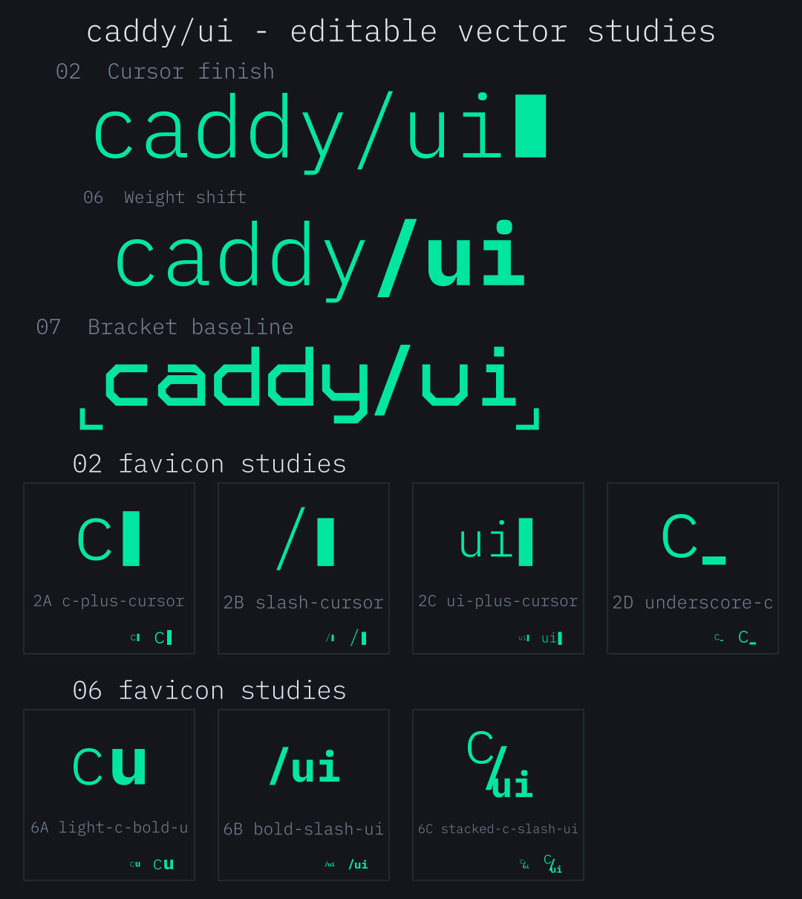

# caddy/ui editable vector studies

Three wordmarks (02, 06 and 07) and seven favicons (2A–2D and 6A–6C), reconstructed as editable SVG artwork from the selected visual studies.

These are clean vector reconstructions, not exact traces of the image-generated lettering. Wordmarks 02/06 and their favicon families use actual IBM Plex Mono outlines. Wordmark 07 uses custom geometric paths inspired by the squared baseline-frame study.

[**Download the complete SVG kit**](caddy-ui-vector-kit.zip?raw=true)

## Start here

- `preview.svg` — an entirely vector overview of all requested designs, including actual 16/32-unit favicon displays.
- `wordmarks/` — the three wordmarks, with transparent backgrounds and outlined lettering.
- `favicons/` — the seven selected favicons, each on a separate removable charcoal background rectangle.
- `live-text/` — optional text-object alternatives for 02/06 and their seven favicons. Install the included fonts before opening these.
- `fonts/` — unmodified IBM Plex Mono Light (300), SemiBold (600), Bold (700), and their SIL Open Font License.

The ten main assets under `wordmarks/` and `favicons/` contain paths and rectangles rather than raster images or font-dependent text. They open without installing any fonts. Lettering, cursors, underscore and corner marks are separated into named groups/objects.

## Editing in Affinity Designer

1. Open the desired SVG using File → Open, then save a working copy as an Affinity document.
2. Expand the named groups in the Layers panel. Use the Node Tool to refine outlined letters, or select a cursor/corner object to move or resize it.
3. Change fills to recolor. Mint is `#00E5A0`; the favicon background is `#14161C`.
4. Hide/delete the favicon's `*-background` rectangle for a transparent variant. The wordmarks are already transparent.
5. For font-based editing, install the included TTFs and open the corresponding `live-text/` file. It uses IBM Plex Mono Light for the light text and Bold for the emphasized suffix. SemiBold is also included for experimenting with a less heavy suffix; favicon 6C uses it for its slash. Font selection names can differ between applications, so reselect the installed weight if Affinity substitutes a font.
6. Keep an editable copy, then export a separate SVG with text converted to curves when portability matters.

07 has no live-text version: its lettering and lower frame corners are custom editable vector geometry.

## Asset list

| ID | File | Construction |
| --- | --- | --- |
| 02 | [wordmarks/02-cursor-finish.svg](wordmarks/02-cursor-finish.svg) | Light full wordmark plus a separate block cursor. |
| 06 | [wordmarks/06-weight-shift.svg](wordmarks/06-weight-shift.svg) | Light `caddy`, bold `/ui`. |
| 07 | [wordmarks/07-bracket-baseline.svg](wordmarks/07-bracket-baseline.svg) | Custom geometric lowercase lettering with separate lower corners. |
| 2A | [favicons/2a-c-plus-cursor.svg](favicons/2a-c-plus-cursor.svg) | Lowercase c and block cursor. |
| 2B | [favicons/2b-slash-cursor.svg](favicons/2b-slash-cursor.svg) | Forward slash and block cursor. |
| 2C | [favicons/2c-ui-plus-cursor.svg](favicons/2c-ui-plus-cursor.svg) | Light ui and block cursor. |
| 2D | [favicons/2d-underscore-c.svg](favicons/2d-underscore-c.svg) | Lowercase c and underscore cursor. |
| 6A | [favicons/6a-light-c-bold-u.svg](favicons/6a-light-c-bold-u.svg) | Light c and bold u on one baseline. |
| 6B | [favicons/6b-bold-slash-ui.svg](favicons/6b-bold-slash-ui.svg) | Bold slash and ui. |
| 6C | [favicons/6c-stacked-c-slash-ui.svg](favicons/6c-stacked-c-slash-ui.svg) | Stacked light c, slash and bold ui. |

Favicons use a `0 0 64 64` viewBox. They were rendered at 16, 32 and 64 px in Chromium. The lighter and multi-character versions naturally have less detail at 16 px; these remain editable studies for optical refinement. Affinity import itself has not been tested in this environment.

## Fonts and reproducibility

Fonts were downloaded from the Google Fonts `ofl/ibmplexmono` directory. Their license and original files are included. `font-sources.json` records source information and SHA-256 checksums.

`build-svg-kit.py` reproduces the assets using Python and `fontTools`. It is optional: editing the SVGs does not require Python. Rerunning it overwrites generated SVGs, so keep your manual edits separately.
