# Backend architecture: current modules, contracts and responsibilities

**Status:** map of the existing implementation, not a target design.

**Source:** [zackwag/caddy-ui at `72bba1f2`](https://github.com/zackwag/caddy-ui/tree/72bba1f22ea1145515c85a87fb90f560e4088a4d/src/backend).

**Inspected:** 17 October 2026. The source checkout contains **42 JavaScript modules** under `src/backend/src/`.

The backend is one Node.js/Express process. Its Docker image runs `node src/index.js`; there is no internal management gateway, message broker, database server or separate worker service. The diagrams group existing files by responsibility. These groups are a reading aid: the code does **not** currently enforce a clean layered architecture.

The [architecture proposal](caddy-ui-architecture-proposal.md) describes intended changes. This document records the starting point for discussing and reviewing those changes. The [frontend companion](frontend-current-architecture.md) maps browser-side responsibilities at the same revision; deployment architecture will be mapped separately.

## Reading the diagrams

- **Dependency diagrams:** `A --> B` means module A imports B or a labeled group of modules depends on another group. Dotted arrows identify literal dynamic imports. Unshown shared dependencies are stated below each diagram.
- **Runtime diagrams:** arrows show requests, calls, results or writes; they do not claim a direct JavaScript import.
- **Sequence diagrams:** show operation order and branches, not a distributed transaction.
- **Contracts:** describe current function signatures, data and observable behavior. They are not generated schemas or promises that every caller has been validated against them.
- All Mermaid blocks are editable Markdown source. Source links stay pinned to the inspected commit even when `main` changes.

## 1. Responsibility groups

**Dependency overview; grouped and intentionally incomplete.** The feature groups contain mixed responsibilities rather than a separate domain/application layer.

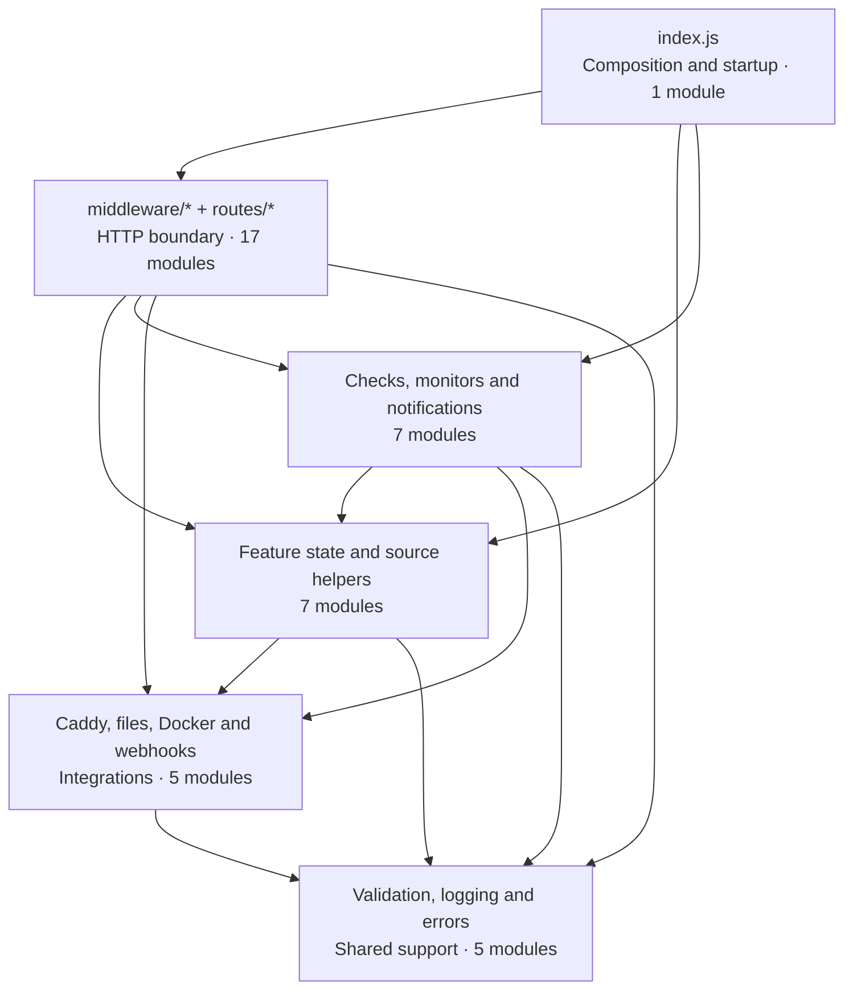

`index.js` also imports shared diagnostics. Its feature groups are not a filter through which all I/O passes: several routers and workers call Node filesystem or network APIs directly. The complete local-import inventory is at the end.

| Group | Existing modules | Responsibility today |
| --- | --- | --- |
| Composition | [index.js][src-index] | Construct Express, register middleware/routes, load state, start monitors and listen. |
| Request middleware | [middleware/auth.js][src-middleware-auth], [middleware/crossSite.js][src-middleware-crossSite], [middleware/instance.js][src-middleware-instance] | Optional JWT verification, browser-origin write checks and instance resolution. |
| HTTP handlers | The 14 files in `routes/`, catalogued below | HTTP handling plus varying amounts of validation, Caddyfile transformation, persistence and monitoring control. |
| Feature state/source helpers | [instances.js][src-instances], [settings.js][src-settings], [serverNames.js][src-serverNames], [maintenance.js][src-maintenance], [customThemes.js][src-customThemes], [languages.js][src-languages], [caddyfileTitles.js][src-caddyfileTitles] | Registrations, application settings, labels, maintenance restoration content, appearance/language settings and title parsing. |
| Monitoring/observations | [upstreamChecks.js][src-upstreamChecks], [upstreamMonitor.js][src-upstreamMonitor], [routeChecks.js][src-routeChecks], [routeMonitor.js][src-routeMonitor], [uptimeHistory.js][src-uptimeHistory], [notifications.js][src-notifications], [updateCheck.js][src-updateCheck] | Collect observations, schedule work, retain history, detect transitions and deliver notifications. |
| Integrations | [caddy.js][src-caddy], [containerFs.js][src-containerFs], [docker.js][src-docker], [dockerDiscovery.js][src-dockerDiscovery], [webhookTransport.js][src-webhookTransport] | Caddy admin HTTP, Docker/local filesystem and command dispatch, container discovery and checked webhook transport. |
| Shared support | [validation.js][src-validation], [logger.js][src-logger], [AppError.js][src-AppError], [errorRegistry.js][src-errorRegistry], [errorReporting.js][src-errorReporting] | Input helpers, application logging, stable error vocabulary and correlated HTTP diagnostics. |

## 2. HTTP boundary and middleware order

**Runtime request flow.** Registration order in [index.js][src-index] matters. Branches represent matching endpoints that handle the request; a router that calls `next()` can continue down the Express stack.

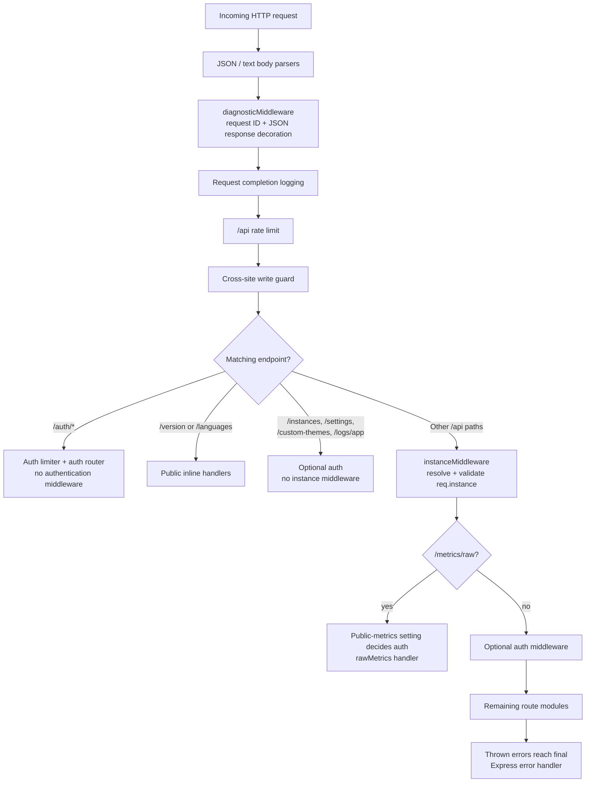

Current boundary facts:

- Authentication is optional. All three auth variables absent disables it; partial, empty or whitespace-only configuration aborts module initialization before listening.
- The cross-site guard checks write requests; it is not a CSRF-token mechanism. Headerless script compatibility remains intentional.
- `instanceMiddleware` runs **before** authentication for the remaining route group. It attaches `{ id, name, adminUrl, configPath, logPath, dataPath, containerName, serverName }`.
- An explicit unknown instance ID currently falls back to the first registered instance through `getInstance()`. No instances produces `503` with `NO_INSTANCES`.
- `/notifications/*` and `/server-names/all` pass through instance middleware despite using installation-wide data. `/logs/app` deliberately bypasses it.
- Public-metrics behavior also has a path-based exception inside `authMiddleware`; the explicit `/metrics/raw` registration is not its only relevant code path. Read [middleware/auth.js][src-middleware-auth] alongside route mounting when changing this policy.
- The final Express error handler receives uncaught errors from all applicable route branches; the diagram draws one error edge for readability.

### Route responsibility and response catalogue

Prefixes below include `/api`. Shapes are summaries; query options and all mutation variants remain in the linked source.

| Module / prefix | Responsibility and outgoing work | Current response contract |
| --- | --- | --- |
| [routes/auth.js][src-routes-auth] · `/auth` | Compare configured credentials; sign JWT; report auth/public-metrics flags. | Session JSON with `token` and `authEnabled`; capability flags from `/status`. |
| [routes/instances.js][src-routes-instances] · `/instances` | Registration CRUD, online checks, live server IDs and Docker discovery. | Instance arrays/objects, `{ id, online }[]`, server-ID arrays and discovery records. |
| [routes/settings.js][src-routes-settings] · `/settings` | Filter settings, normalize language/exclusions; trigger checks when enabled. | Installation settings object. |
| [routes/customThemes.js][src-routes-customThemes] · `/custom-themes` | Expose loaded theme catalogue. | Theme array. |
| [routes/caddyfile.js][src-routes-caddyfile] · `/caddyfile` | Read/download, validate, format, sort, snapshot, persist and reload source. | Plain text for source/snapshots; JSON lists and validation/save results. |
| [routes/routes.js][src-routes-routes] · `/routes` | Read live route JSON; simple-route, source-block and maintenance mutations. | Raw Caddy route objects plus `_server`/`_simpleProxy`; mutation results and maintenance map. |
| [routes/status.js][src-routes-status] · `/status` | Read live configuration, metrics, upstream checks and Caddy version. | Status object, including HTTP-200 `online: false`; `/process` uses `ok`. |
| [routes/logs.js][src-routes-logs] · `/logs`, `/logs/app` | Tail Caddy logs, stream application entries, read/change log configuration. | Caddy `{ lines, path }`, app `{ entries }`, SSE events or configuration JSON. |
| [routes/metrics.js][src-routes-metrics] · `/metrics` | Scrape/parse metrics, export history, read/change metrics configuration. | Parsed JSON with `ok`; `/raw` exports Prometheus text; config uses JSON. |
| [routes/servernames.js][src-routes-servernames] · `/server-names` | Selected-instance labels plus installation-wide `/all`. | Label maps and mutation acknowledgements. |
| [routes/tls.js][src-routes-tls] · `/tls` | Inspect certificate files and managed names; guarded deletion; root-CA download. | Certificate array, deletion result or public CA certificate bytes. |
| [routes/health.js][src-routes-health] · `/health` | Run upstream checks, record samples and expose uptime/history/route failures. | Check arrays, target-keyed statistics and historical entries. |
| [routes/routenotes.js][src-routes-routenotes] · `/route-notes` | Read/write shared notes; overlay selected-instance source titles. | Domain-keyed note/title map and write acknowledgement. |
| [routes/notifications.js][src-routes-notifications] · `/notifications` | Persist provider configuration, update monitor and send a test notification. | Configuration object, including configured provider values; test result/error. |

`/version` and `/languages` live directly in `index.js`. `rawMetrics` and `appLogsRouter` are exported by route modules but mounted separately for their different boundary requirements.

## 3. Startup, state loading and timers

**Runtime lifecycle, following `index.js`.** The initial monitor calls are launched rather than awaited before the server starts accepting requests.

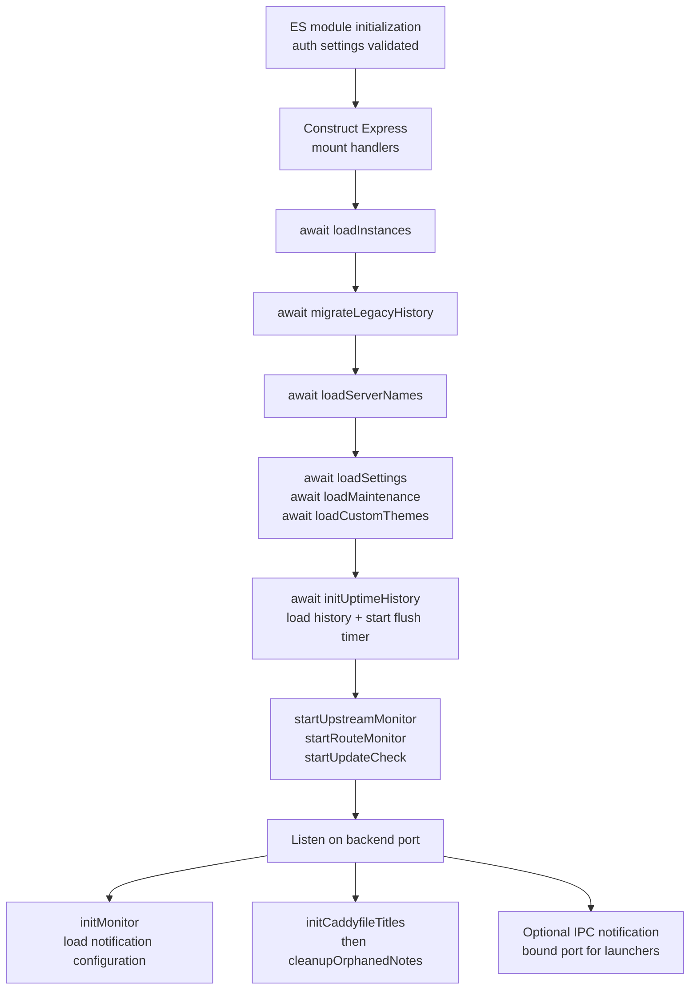

| Work | Owner / trigger | Cadence and relevant lifetime |
| --- | --- | --- |
| Upstream history collection | `startUpstreamMonitor()` | Initial run, then 30 s; all instances. |
| HTTP route checks | `startRouteMonitor()` / `runRouteChecks()` | Initial eligible run, then 5 min; requires `settings.routeChecks`; in-flight run is shared. Enabling checks also triggers a run. |
| Notification checks | `initMonitor()` / `updateMonitorConfig()` | Initial run and 30 s while enabled; applicable upstream/certificate/update triggers. Internal stop function clears this timer when disabled. |
| Update manifest | `startUpdateCheck()` | Initial refresh and hourly while update checks are enabled; retains last good manifest. |
| History persistence | `initUptimeHistory()` | Dirty history flushed every 60 s; default retention is seven days. |
| Application-log SSE heartbeat | `appLogsRouter` connection | Every 25 s; timer/subscription cleared on client close. |
| Caddy-log tail | Caddy `/logs/stream` connection | Child process per stream; killed on client close. |

There is no unified backend shutdown coordinator in `index.js`. Several monitor timers are unreferenced, but that is not the same as exposing explicit stop/drain/flush behavior for every owner.

## 4. Configuration changes and integration dependencies

**Selected direct imports.** This shows why the current code cannot be described as routers delegating all changes to one application service.

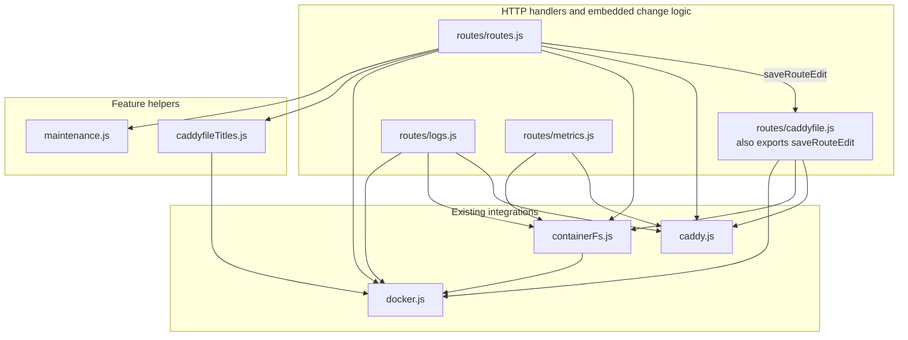

Shared logger/error imports are omitted. These routers also perform direct I/O: Caddyfile history uses `fs/promises`, and adaptation/metrics calls sometimes use `fetch` directly rather than `caddy.js`.

### Full Caddyfile save

**Runtime sequence for `PUT /api/caddyfile`, after request middleware.** This reflects current ordering, including validation before optional formatting/sorting.

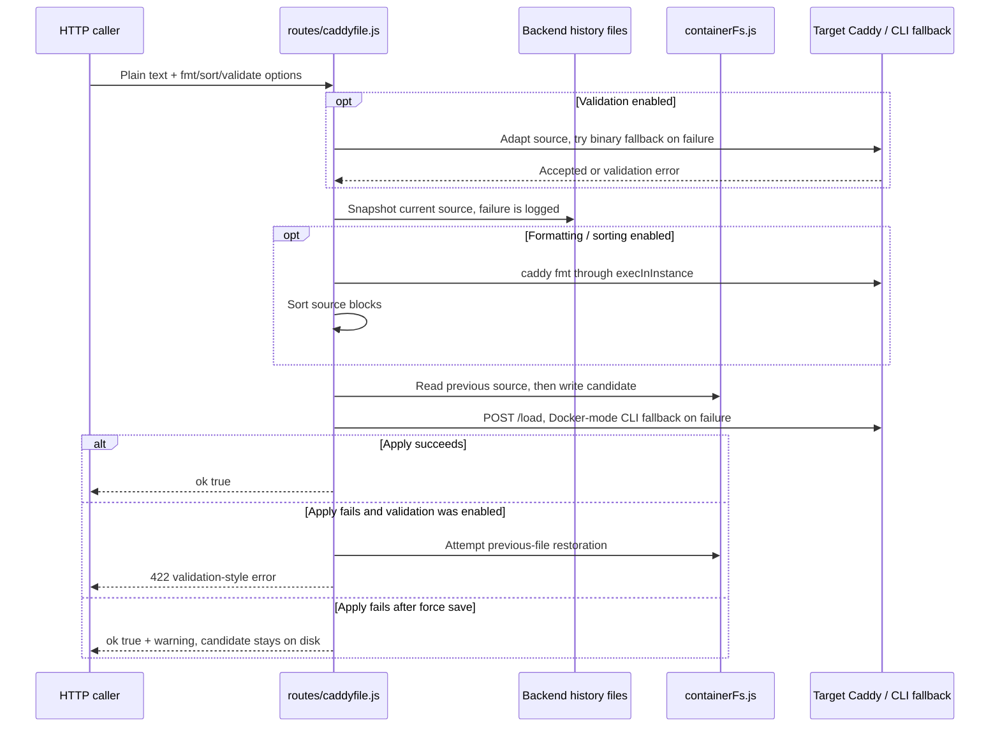

Early validation or filesystem failures can end the operation before later steps. Snapshot and restoration failures are not uniformly promoted to explicit outcomes. There is no revision/precondition check, common per-instance configuration queue or durable apply-outcome record in this path.

### The current write paths differ

| Entry path | Live/file order | Current safety behavior |
| --- | --- | --- |
| Full Caddyfile save | Validate input unless forced; snapshot; optionally format/sort; write; apply. | Attempts file restoration on apply failure unless forced. Snapshots are best effort. |
| Source-block and maintenance edits | Compute new source; `saveRouteEdit` snapshots/writes/applies. | Attempts file restoration on apply failure. It does not reuse the full editor's validation/format/sort sequence. |
| Simple route create/update/delete | Modify live JSON first; then persist source through `saveRouteEdit(..., { reload: false })` when the path can determine the source change. | A later persistence failure has no matching live-change rollback. Some update/delete paths continue without a mapped source domain. |
| Metrics configuration | Transform source; write file; `caddyLoad`. | No matching file restoration in this handler. |
| Logs configuration | Transform source; adapt; write file; `caddyLoad`. | No matching file restoration in this handler. |
| Source reload | Read file; `reloadCaddy`. | Applies existing disk contents; does not create a new save/snapshot operation. |

These are existing semantics, not recommended guarantees. The proposed coordinator belongs to a later slice.

## 5. Observations, history and notification ownership

**Runtime collection flow.** Arrows label operations rather than imports. Route notifications already consume route-monitor results; upstream notifications initiate their own collection.

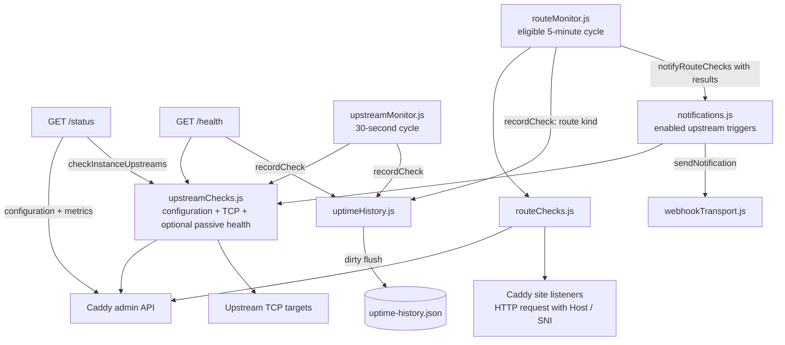

Contract distinctions:

| Observation | Meaning today | Scope / shape |
| --- | --- | --- |
| Instance status | HTTP success from that instance's `/config/`. | `{ id, online }[]`; failures become `online: false`. |
| `/status.online` | Whether the live HTTP-server configuration can be read. Metrics and upstream checks are optional to this decision. | Selected-instance summary. |
| Upstream check | TCP connection from the backend, combined with passive failure information when applicable. | `{ domain, upstream, host, port, server, online }[]`; not an end-user HTTP check. |
| Route check | Request to the instance address/listener, with route Host and TLS identity. Responses below 500 count as up, including redirects/auth challenges. | `{ host, scheme, port, server, statusCode, online, error }[]`. Concrete first-host targets are selected; not every arbitrary route/matcher is probeable. |
| Uptime statistic | Fraction of retained samples marked online, plus current streak information. | Per instance, target and kind; not a time-weighted service-level availability calculation. |
| Certificate list | Parsed certificate files, enriched with names inferred from live configuration. | Selected-instance certificate array; stored certificate state is not a direct proof of a site's active protocol. |

Collection sharing is limited: TCP targets are deduplicated **inside one upstream-check invocation**; its callers do not share a common in-flight result. `/status` also fetches the same server configuration directly and through this checker. `GET /health` appends history, so reads and scheduled sampling currently overlap. Route checks do share a running monitor invocation.

## 6. State and persistence boundaries

**Runtime ownership/data flow.** Each box names the code currently responsible for state; the JSON stores are backend-local metadata, not Caddy's live configuration.

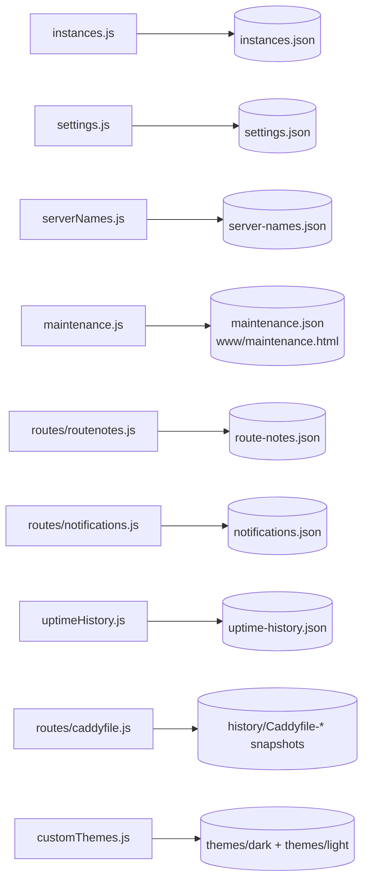

| Owner | Default target, relative to `/etc/caddy-ui/` unless noted | In-memory state / identity |
| --- | --- | --- |
| `instances.js` | `instances.json`; environment bootstrap when unavailable. | Registry array; instance ID. Writes have a local Promise queue; mutation methods also modify the live array. |
| `settings.js` | `settings.json`. | Installation settings object; state changes before queued persistence completes. |
| `serverNames.js` | `server-names.json`. | Nested `instanceId -> serverId -> label`; startup migrates older label maps. |
| `maintenance.js` | `maintenance.json` and `www/maintenance.html`. | **Domain-only** restoration records `{ originalContent, enabledAt }`; not isolated by instance. |
| `routes/routenotes.js` | `route-notes.json`. | Read/modify/write per request; **domain-only** notes, overlaid with selected-instance source titles. |
| `routes/notifications.js` | `notifications.json`. | File configuration returned to HTTP callers and loaded by the worker. Worker holds its own current configuration. |
| `uptimeHistory.js` | `uptime-history.json`. | Map keys combine instance with upstream or route host; samples are `{ online, at }`. |
| `routes/caddyfile.js` | `history/`, with instance subdirectories except legacy/default layout. | Up to 20 source snapshots per instance; timestamp-based filenames. |
| `customThemes.js` | `themes/dark/` and `themes/light/`. | Catalogue loaded at startup; seeds supported formats/examples in these folders. |
| `caddyfileTitles.js` | Reads `route-notes.json`; parses source supplied by callers. | Process-wide title-mode choice and title extraction/injection. |
| `languages.js` | Environment and code-defined admission list; no JSON store. | Reviewed languages plus additional admitted codes; setting normalization. Font availability is reported separately from frontend font packaging. |

Paths have environment overrides in their source modules. Caddy's configured `configPath`, `logPath` and `dataPath` are separate instance targets accessed through the file/command adapters. No shared repository abstraction, transactional JSON store or universal metadata schema exists.

### Current structural contracts at important seams

These are existing plain values, not newly proposed classes. Field lists focus on boundary identity and results rather than every optional presentation field.

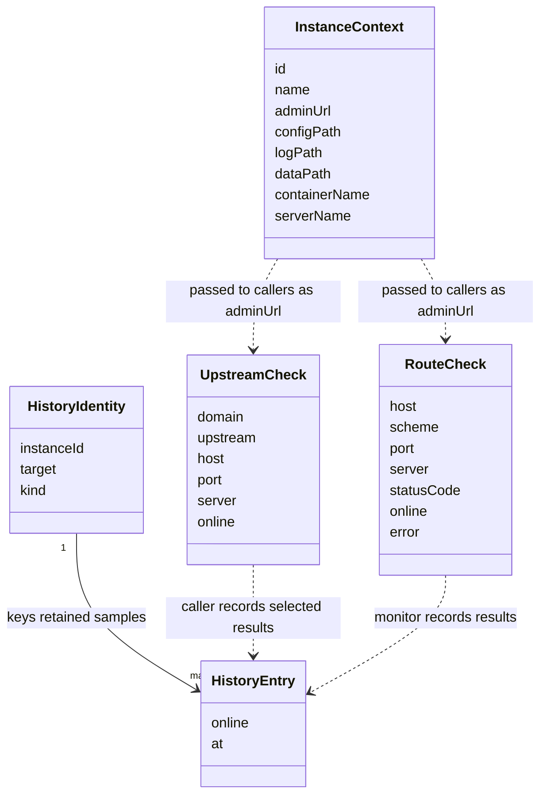

The instance context is attached to the request, but the checker functions receive `adminUrl`, not the complete context. Callers supply instance identity when recording history. This split matters when evaluating caching or shared collection.

| Existing function seam | Input | Output / side effect |
| --- | --- | --- |
| `caddyGet/Put/Post/Patch/Delete` | Path, optional body and admin URL. | Parsed JSON, text or null; throws on failed HTTP/timeout. |
| `caddyLoad` | Caddyfile text and admin URL. | Resolves on `/load` success; throws otherwise. |
| `read/writeContainerFile` | Container name, path and optional content. | Text / completed write; dispatches to Docker or local filesystem. |
| `execInInstance` / `spawnInInstance` | Container name, command, arguments and optional input. | Collected `{ stdout, stderr }` / raw child process. |
| `checkInstanceUpstreams` | Admin URL. | Upstream-check array; throws when required configuration cannot be read. |
| `checkInstanceRoutes` | Admin URL and exclusion list. | Route-check array; per-target request failures are result data. |
| `recordCheck` | Instance ID, target, online boolean and kind. | Appends an in-memory historical sample and marks state dirty. |
| `saveRouteEdit` | Instance, replacement source and reload option. | Snapshot/write, optionally apply/restore; throws on failures not swallowed internally. |
| `sendNotification` | Provider configuration and `{ title, message, priority }`. | Provider payload creation and delivery; throws on failure. |
| `sendWebhook` | URL, request description and optional test/deadline options. | Checked delivery; resolves only for 2xx. |

## 7. External I/O and Docker/local modes

**Runtime dispatch.** These are process/file/network boundaries, not separate backend services.

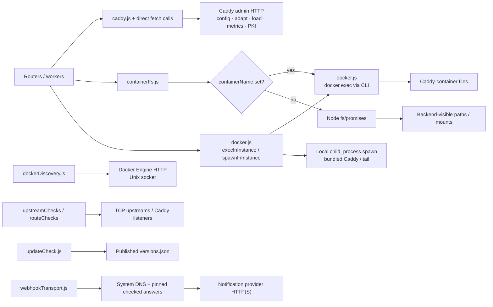

Important differences:

- `containerFs.js` selects mode per operation from the instance's container name. Discovery instead uses the Docker Engine socket directly; `DOCKER_SOCKET` is not a universal transport setting for `docker exec`.
- `docker.js` also reads/caches container environment values for Caddyfile variable resolution. Local mode uses the backend process environment.
- The image contains `docker-cli` and a Caddy binary. Docker-mode commands run the target container's binary; local-mode commands run locally.
- Caddy admin calls are not universally routed through `caddy.js`. Status, metrics, instance checks, adaptation and CA retrieval also contain direct requests with their own timeout behavior.
- `caddy.js` uses a Promise-race timeout around `fetch`; it does not cancel the request and does not put the later response-body read inside that timeout. Webhook delivery has a different, abortable end-to-end deadline.

## 8. Credentials and request policy

**Runtime credential use.** Arrows show where credential-bearing values travel, not stored example credentials.

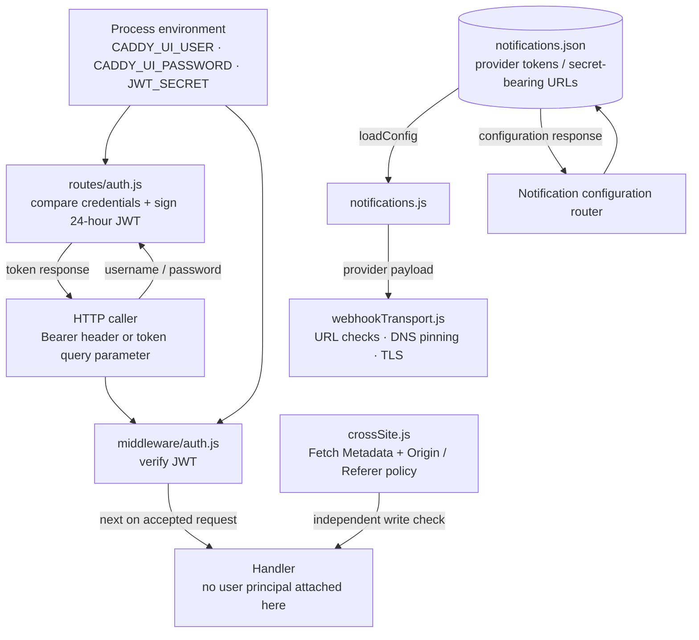

Current responsibilities and limits:

| Concern | Existing owner / behavior |
| --- | --- |
| Auth admission | `middleware/auth.js` validates the three environment values at import time. All absent opts out; partial configuration refuses startup. |
| Login | `routes/auth.js` compares one configured username/password and signs a 24-hour JWT. There is no account database or passkey/session registry in this backend. |
| Request identity | `authMiddleware` verifies a query token or Bearer header. It does not attach the verified claims as a request principal or enforce per-user/per-route scopes. |
| Browser-origin writes | `crossSite.js` uses request metadata and optional `CADDY_UI_EXTERNAL_URL`; it preserves documented headerless script compatibility. |
| Caddy admin access | Instance URL plus fixed request headers; no general per-instance credential-provider interface. `Origin` is not an authentication credential. |
| Docker authority | Availability of Docker CLI/Engine access. Container-name/path checks do not turn Docker access into fine-grained user authorization. |
| Provider configuration | File-based values, including Pushover tokens and provider URLs. The config API returns those values; there is no dedicated secret store or redacted write-only credential contract here. |
| Provider destination policy | Private networks allowed; loopback/link-local/non-routable ranges and explicit metadata addresses blocked. Reject any blocked DNS answer; connect through checked answers while retaining hostname TLS checks. |
| Delivery bounds | Webhook DNS/connect/TLS/body share a 10 s default deadline; response limited to 64 KiB; redirects not followed. Address fallback is during connection establishment, not application-level POST retries. |

These facts explain the existing trust boundaries. They do not prescribe an identity platform, route-ownership gateway or new secret-management service.

## 9. Error and diagnostic contract

**Runtime flow for a structured application error.** Legacy route responses and the final Express handler also pass through the diagnostic JSON wrapper when applicable.

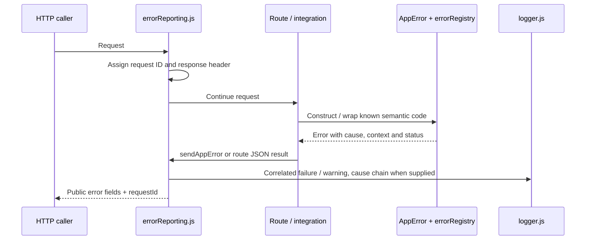

| Module | Contract responsibility |
| --- | --- |
| `errorRegistry.js` | Known semantic codes and default HTTP status/log level. |
| `AppError.js` | Known-code construction, cause/context retention, public-error projection. |
| `errorReporting.js` | Request ID, response decoration, legacy status-to-code fallback and correlated failure logging. |
| `logger.js` | Console output, bounded 500-entry memory buffer and subscriptions. |

The wrapper recognizes selected HTTP-200 soft failures (`ok: false` with an error, and `/status` offline-with-error). It does not turn a successful empty array into an unavailable-resource response, nor does it normalize every endpoint to one response envelope. Plain text, certificate downloads and SSE remain separate protocols. `publicError()` omits cause/stack/context, but legacy handlers returning `err.message` do not automatically use that projection.

## 10. Existing events and streams

**Runtime event flow.** This is the actual in-process/event-stream behavior; there is no durable application event log or broker.

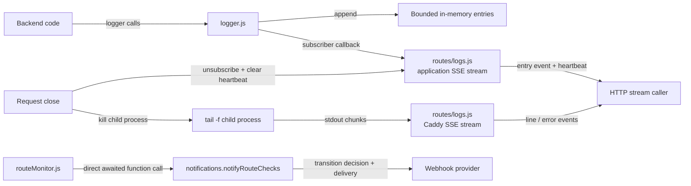

Application SSE entries are structured logger objects; Caddy SSE entries are lines wrapped in `{ line }` or stream errors. Logger subscribers do not supply transactional configuration-change events. The route-monitor notification call already separates one collection from an alert consumer, but remains a direct dependency.

## 11. Boundary crossings to use when planning slices

**Selected direct-import detail.** Dotted arrows are dynamic imports; ordinary arrows are static imports. This intentionally highlights coupling rather than inventing proposed interfaces.

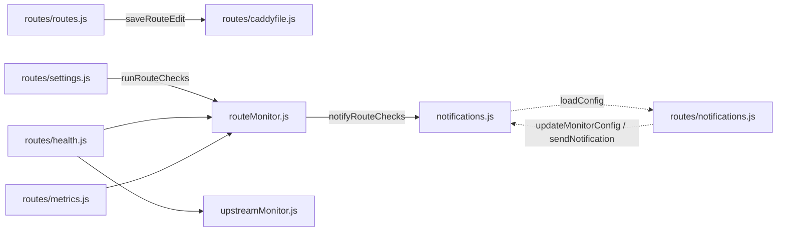

| Existing crossing | Why it matters to the architecture discussion |
| --- | --- |
| A router imports another router's save function. | Configuration behavior is reusable, but its owner is still an HTTP module. |
| Worker and notification router dynamically import one another. | Configuration persistence, monitor control and provider delivery are coupled across the HTTP boundary. This is a literal dynamic-import cycle, not an eagerly evaluated static-import cycle. |
| Read routes import monitor modules. | History/failure data and interval constants are exposed through scheduling owners. |
| `/status`, `/health`, upstream monitor and notification monitor call the same collector independently. | Shared implementation does not establish shared observation ownership. |
| Global notes/maintenance are addressed using selected-instance HTTP paths. | Instance selection and storage identity disagree. |
| Route responses expose Caddy handler trees with extra UI fields. | Consumers depend on raw configuration structure alongside UI editing assumptions. |

These are the current seams behind [#300](https://github.com/zackwag/caddy-ui/issues/300) and its slices. They are not instructions to move every file into a new folder or deploy additional tiers. Responsibility groups can become clearer through small module extractions and explicit contracts inside the existing process.

## 12. Complete local-import inventory

All 42 source modules and their direct local dependencies

The inventory follows literal relative `import ... from` and `import('...')` declarations in the pinned source. Repeated dynamic imports of the same target are listed once per module. Node built-ins, npm dependencies and global `fetch` calls are excluded: this table describes module coupling, not a complete runtime call graph. Index/startup imports are retained rather than hidden.

| Module | Direct local imports |
| --- | --- |
| [AppError.js][src-AppError] | [errorRegistry.js][src-errorRegistry] |
| [caddy.js][src-caddy] | [logger.js][src-logger] |
| [caddyfileTitles.js][src-caddyfileTitles] | [docker.js][src-docker], [logger.js][src-logger] |
| [containerFs.js][src-containerFs] | [docker.js][src-docker] |
| [customThemes.js][src-customThemes] | [logger.js][src-logger] |
| [docker.js][src-docker] | [logger.js][src-logger] |
| [dockerDiscovery.js][src-dockerDiscovery] | [logger.js][src-logger] |
| [errorRegistry.js][src-errorRegistry] | None |
| [errorReporting.js][src-errorReporting] | [logger.js][src-logger], [AppError.js][src-AppError], [errorRegistry.js][src-errorRegistry] |
| [index.js][src-index] | [customThemes.js][src-customThemes], [instances.js][src-instances], [logger.js][src-logger], [errorReporting.js][src-errorReporting], [middleware/auth.js][src-middleware-auth], [middleware/crossSite.js][src-middleware-crossSite], [middleware/instance.js][src-middleware-instance], [notifications.js][src-notifications], [routes/auth.js][src-routes-auth], [routes/caddyfile.js][src-routes-caddyfile], [routes/customThemes.js][src-routes-customThemes], [routes/health.js][src-routes-health], [routes/instances.js][src-routes-instances], [routes/logs.js][src-routes-logs], [routes/metrics.js][src-routes-metrics], [routes/notifications.js][src-routes-notifications], [routes/settings.js][src-routes-settings], [caddyfileTitles.js][src-caddyfileTitles], [routes/routenotes.js][src-routes-routenotes], [routes/routes.js][src-routes-routes], [routes/servernames.js][src-routes-servernames], [routes/status.js][src-routes-status], [routes/tls.js][src-routes-tls], [routeMonitor.js][src-routeMonitor], [maintenance.js][src-maintenance], [serverNames.js][src-serverNames], [settings.js][src-settings], [uptimeHistory.js][src-uptimeHistory], [updateCheck.js][src-updateCheck], [upstreamMonitor.js][src-upstreamMonitor], [languages.js][src-languages] |
| [instances.js][src-instances] | [AppError.js][src-AppError], [logger.js][src-logger] |
| [languages.js][src-languages] | None |
| [logger.js][src-logger] | None |
| [maintenance.js][src-maintenance] | [logger.js][src-logger] |
| [middleware/auth.js][src-middleware-auth] | None |
| [middleware/crossSite.js][src-middleware-crossSite] | [AppError.js][src-AppError], [errorReporting.js][src-errorReporting] |
| [middleware/instance.js][src-middleware-instance] | [instances.js][src-instances], [validation.js][src-validation] |
| [notifications.js][src-notifications] | [containerFs.js][src-containerFs], [instances.js][src-instances], [logger.js][src-logger], [routeChecks.js][src-routeChecks], [updateCheck.js][src-updateCheck], [upstreamChecks.js][src-upstreamChecks], [webhookTransport.js][src-webhookTransport], [routes/notifications.js][src-routes-notifications] (dynamic) |
| [routeChecks.js][src-routeChecks] | [caddy.js][src-caddy], [upstreamChecks.js][src-upstreamChecks] |
| [routeMonitor.js][src-routeMonitor] | [instances.js][src-instances], [logger.js][src-logger], [notifications.js][src-notifications], [routeChecks.js][src-routeChecks], [settings.js][src-settings], [uptimeHistory.js][src-uptimeHistory] |
| [routes/auth.js][src-routes-auth] | [middleware/auth.js][src-middleware-auth] |
| [routes/caddyfile.js][src-routes-caddyfile] | [caddy.js][src-caddy], [containerFs.js][src-containerFs], [docker.js][src-docker], [instances.js][src-instances], [logger.js][src-logger], [AppError.js][src-AppError], [errorReporting.js][src-errorReporting] |
| [routes/customThemes.js][src-routes-customThemes] | [customThemes.js][src-customThemes] |
| [routes/health.js][src-routes-health] | [routeMonitor.js][src-routeMonitor], [uptimeHistory.js][src-uptimeHistory], [upstreamChecks.js][src-upstreamChecks], [upstreamMonitor.js][src-upstreamMonitor] |
| [routes/instances.js][src-routes-instances] | [caddy.js][src-caddy], [dockerDiscovery.js][src-dockerDiscovery], [instances.js][src-instances], [logger.js][src-logger], [AppError.js][src-AppError], [errorReporting.js][src-errorReporting], [serverNames.js][src-serverNames], [validation.js][src-validation] |
| [routes/logs.js][src-routes-logs] | [caddy.js][src-caddy], [containerFs.js][src-containerFs], [docker.js][src-docker], [logger.js][src-logger] |
| [routes/metrics.js][src-routes-metrics] | [containerFs.js][src-containerFs], [caddy.js][src-caddy], [instances.js][src-instances], [logger.js][src-logger], [AppError.js][src-AppError], [errorReporting.js][src-errorReporting], [routeMonitor.js][src-routeMonitor], [uptimeHistory.js][src-uptimeHistory] |
| [routes/notifications.js][src-routes-notifications] | [logger.js][src-logger], [AppError.js][src-AppError], [errorReporting.js][src-errorReporting], [notifications.js][src-notifications] (dynamic) |
| [routes/routenotes.js][src-routes-routenotes] | [caddy.js][src-caddy], [caddyfileTitles.js][src-caddyfileTitles], [containerFs.js][src-containerFs], [instances.js][src-instances], [logger.js][src-logger] |
| [routes/routes.js][src-routes-routes] | [caddy.js][src-caddy], [caddyfileTitles.js][src-caddyfileTitles], [containerFs.js][src-containerFs], [docker.js][src-docker], [logger.js][src-logger], [maintenance.js][src-maintenance], [routes/caddyfile.js][src-routes-caddyfile] |
| [routes/servernames.js][src-routes-servernames] | [serverNames.js][src-serverNames] |
| [routes/settings.js][src-routes-settings] | [languages.js][src-languages], [routeChecks.js][src-routeChecks], [routeMonitor.js][src-routeMonitor], [settings.js][src-settings] |
| [routes/status.js][src-routes-status] | [caddy.js][src-caddy], [docker.js][src-docker], [logger.js][src-logger], [AppError.js][src-AppError], [upstreamChecks.js][src-upstreamChecks] |
| [routes/tls.js][src-routes-tls] | [caddy.js][src-caddy], [containerFs.js][src-containerFs], [logger.js][src-logger], [AppError.js][src-AppError], [errorReporting.js][src-errorReporting] |
| [serverNames.js][src-serverNames] | [logger.js][src-logger] |
| [settings.js][src-settings] | [logger.js][src-logger] |
| [updateCheck.js][src-updateCheck] | [logger.js][src-logger] |
| [upstreamChecks.js][src-upstreamChecks] | [caddy.js][src-caddy] |
| [upstreamMonitor.js][src-upstreamMonitor] | [instances.js][src-instances], [logger.js][src-logger], [uptimeHistory.js][src-uptimeHistory], [upstreamChecks.js][src-upstreamChecks] |
| [uptimeHistory.js][src-uptimeHistory] | [logger.js][src-logger] |
| [validation.js][src-validation] | None |
| [webhookTransport.js][src-webhookTransport] | [AppError.js][src-AppError] |

## Updating this map

Read the changed modules and route mounting order before changing a diagram. Update the pinned source commit, responsibility catalogue, local-import inventory and relevant runtime/contract sections together. In particular, an import edge alone does not prove a call is used by every request, and a request count does not establish backend cost.

Diagrams are documentation, not enforcement. Source inspection and the local-import inventory support this map; they do not replace integration tests for behavior. The map adds no application changes and makes no new production timing claim.

Documentation checks: all 13 Mermaid diagrams were parsed and rendered with Mermaid 12.2.0 in headless Chromium. The 42 pinned module references, inventory coverage and local document links were checked. These checks validate the map's source coverage and rendering, not application behavior.

[src-AppError]: https://github.com/zackwag/caddy-ui/blob/72bba1f22ea1145515c85a87fb90f560e4088a4d/src/backend/src/AppError.js
[src-caddy]: https://github.com/zackwag/caddy-ui/blob/72bba1f22ea1145515c85a87fb90f560e4088a4d/src/backend/src/caddy.js
[src-caddyfileTitles]: https://github.com/zackwag/caddy-ui/blob/72bba1f22ea1145515c85a87fb90f560e4088a4d/src/backend/src/caddyfileTitles.js
[src-containerFs]: https://github.com/zackwag/caddy-ui/blob/72bba1f22ea1145515c85a87fb90f560e4088a4d/src/backend/src/containerFs.js
[src-customThemes]: https://github.com/zackwag/caddy-ui/blob/72bba1f22ea1145515c85a87fb90f560e4088a4d/src/backend/src/customThemes.js
[src-docker]: https://github.com/zackwag/caddy-ui/blob/72bba1f22ea1145515c85a87fb90f560e4088a4d/src/backend/src/docker.js
[src-dockerDiscovery]: https://github.com/zackwag/caddy-ui/blob/72bba1f22ea1145515c85a87fb90f560e4088a4d/src/backend/src/dockerDiscovery.js
[src-errorRegistry]: https://github.com/zackwag/caddy-ui/blob/72bba1f22ea1145515c85a87fb90f560e4088a4d/src/backend/src/errorRegistry.js
[src-errorReporting]: https://github.com/zackwag/caddy-ui/blob/72bba1f22ea1145515c85a87fb90f560e4088a4d/src/backend/src/errorReporting.js
[src-index]: https://github.com/zackwag/caddy-ui/blob/72bba1f22ea1145515c85a87fb90f560e4088a4d/src/backend/src/index.js
[src-instances]: https://github.com/zackwag/caddy-ui/blob/72bba1f22ea1145515c85a87fb90f560e4088a4d/src/backend/src/instances.js
[src-languages]: https://github.com/zackwag/caddy-ui/blob/72bba1f22ea1145515c85a87fb90f560e4088a4d/src/backend/src/languages.js
[src-logger]: https://github.com/zackwag/caddy-ui/blob/72bba1f22ea1145515c85a87fb90f560e4088a4d/src/backend/src/logger.js
[src-maintenance]: https://github.com/zackwag/caddy-ui/blob/72bba1f22ea1145515c85a87fb90f560e4088a4d/src/backend/src/maintenance.js
[src-middleware-auth]: https://github.com/zackwag/caddy-ui/blob/72bba1f22ea1145515c85a87fb90f560e4088a4d/src/backend/src/middleware/auth.js
[src-middleware-crossSite]: https://github.com/zackwag/caddy-ui/blob/72bba1f22ea1145515c85a87fb90f560e4088a4d/src/backend/src/middleware/crossSite.js
[src-middleware-instance]: https://github.com/zackwag/caddy-ui/blob/72bba1f22ea1145515c85a87fb90f560e4088a4d/src/backend/src/middleware/instance.js
[src-notifications]: https://github.com/zackwag/caddy-ui/blob/72bba1f22ea1145515c85a87fb90f560e4088a4d/src/backend/src/notifications.js
[src-routeChecks]: https://github.com/zackwag/caddy-ui/blob/72bba1f22ea1145515c85a87fb90f560e4088a4d/src/backend/src/routeChecks.js
[src-routeMonitor]: https://github.com/zackwag/caddy-ui/blob/72bba1f22ea1145515c85a87fb90f560e4088a4d/src/backend/src/routeMonitor.js
[src-routes-auth]: https://github.com/zackwag/caddy-ui/blob/72bba1f22ea1145515c85a87fb90f560e4088a4d/src/backend/src/routes/auth.js
[src-routes-caddyfile]: https://github.com/zackwag/caddy-ui/blob/72bba1f22ea1145515c85a87fb90f560e4088a4d/src/backend/src/routes/caddyfile.js
[src-routes-customThemes]: https://github.com/zackwag/caddy-ui/blob/72bba1f22ea1145515c85a87fb90f560e4088a4d/src/backend/src/routes/customThemes.js
[src-routes-health]: https://github.com/zackwag/caddy-ui/blob/72bba1f22ea1145515c85a87fb90f560e4088a4d/src/backend/src/routes/health.js
[src-routes-instances]: https://github.com/zackwag/caddy-ui/blob/72bba1f22ea1145515c85a87fb90f560e4088a4d/src/backend/src/routes/instances.js
[src-routes-logs]: https://github.com/zackwag/caddy-ui/blob/72bba1f22ea1145515c85a87fb90f560e4088a4d/src/backend/src/routes/logs.js
[src-routes-metrics]: https://github.com/zackwag/caddy-ui/blob/72bba1f22ea1145515c85a87fb90f560e4088a4d/src/backend/src/routes/metrics.js
[src-routes-notifications]: https://github.com/zackwag/caddy-ui/blob/72bba1f22ea1145515c85a87fb90f560e4088a4d/src/backend/src/routes/notifications.js
[src-routes-routenotes]: https://github.com/zackwag/caddy-ui/blob/72bba1f22ea1145515c85a87fb90f560e4088a4d/src/backend/src/routes/routenotes.js
[src-routes-routes]: https://github.com/zackwag/caddy-ui/blob/72bba1f22ea1145515c85a87fb90f560e4088a4d/src/backend/src/routes/routes.js
[src-routes-servernames]: https://github.com/zackwag/caddy-ui/blob/72bba1f22ea1145515c85a87fb90f560e4088a4d/src/backend/src/routes/servernames.js
[src-routes-settings]: https://github.com/zackwag/caddy-ui/blob/72bba1f22ea1145515c85a87fb90f560e4088a4d/src/backend/src/routes/settings.js
[src-routes-status]: https://github.com/zackwag/caddy-ui/blob/72bba1f22ea1145515c85a87fb90f560e4088a4d/src/backend/src/routes/status.js
[src-routes-tls]: https://github.com/zackwag/caddy-ui/blob/72bba1f22ea1145515c85a87fb90f560e4088a4d/src/backend/src/routes/tls.js
[src-serverNames]: https://github.com/zackwag/caddy-ui/blob/72bba1f22ea1145515c85a87fb90f560e4088a4d/src/backend/src/serverNames.js
[src-settings]: https://github.com/zackwag/caddy-ui/blob/72bba1f22ea1145515c85a87fb90f560e4088a4d/src/backend/src/settings.js
[src-updateCheck]: https://github.com/zackwag/caddy-ui/blob/72bba1f22ea1145515c85a87fb90f560e4088a4d/src/backend/src/updateCheck.js
[src-upstreamChecks]: https://github.com/zackwag/caddy-ui/blob/72bba1f22ea1145515c85a87fb90f560e4088a4d/src/backend/src/upstreamChecks.js
[src-upstreamMonitor]: https://github.com/zackwag/caddy-ui/blob/72bba1f22ea1145515c85a87fb90f560e4088a4d/src/backend/src/upstreamMonitor.js
[src-uptimeHistory]: https://github.com/zackwag/caddy-ui/blob/72bba1f22ea1145515c85a87fb90f560e4088a4d/src/backend/src/uptimeHistory.js
[src-validation]: https://github.com/zackwag/caddy-ui/blob/72bba1f22ea1145515c85a87fb90f560e4088a4d/src/backend/src/validation.js
[src-webhookTransport]: https://github.com/zackwag/caddy-ui/blob/72bba1f22ea1145515c85a87fb90f560e4088a4d/src/backend/src/webhookTransport.js
