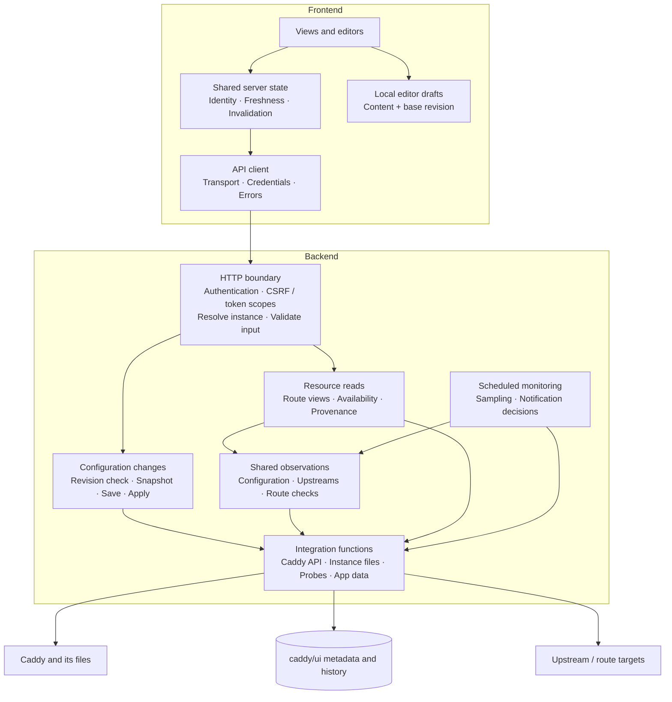

# Proposal: lightweight architecture and explicit boundaries for caddy/ui

**Status:** discussion draft. Organizes the work proposed in [#300](https://github.com/zackwag/caddy-ui/issues/300) through independently reviewable fixes for #301–309.

## Purpose and scope

caddy/ui should remain a small, Caddyfile-first management tool. A user must be able to stop using the UI and continue managing the same configuration with Caddy's normal tools. Reliability, understandable code, and safe recovery take priority over additional features.

The existing [architecture page](https://www.zackwag.com/caddy-ui/architecture.html) documents deployment, connections, and storage. This proposal complements that overview with internal responsibilities, dependency rules, and observable guarantees. It keeps the existing React frontend and Express backend, Docker and local modes, optional authentication, and file-based persistence.

The proposal requires no additional service, middleware container, database server, Git repository, or private PKI. Authentication improvements remain separate work under #286 and #110; these boundaries give them consistent places to operate.

## 1. Dependency direction

Each responsibility has one owner. Consumers call that owner rather than reproducing its work. A shared helper does not establish ownership if every caller still starts its own polling, probes, or writes.



Arrows show allowed calls; responses return along those calls. The integration box groups separate functions, not a new universal interface. Ordinary proxy traffic continues directly through Caddy, independent of the frontend and backend.

Dependency rules:

- Views use the API client and shared resource state. They do not interpret arbitrary Caddy handler trees or each establish a polling cycle for the same resource.
- HTTP handlers translate requests and results. Configuration lifecycle rules live outside routers; one router never imports another router's business logic.
- Application operations own policies and sequencing. Integration functions perform HTTP, filesystem, Docker, and probe work without importing routes or frontend concerns.
- Timers are started and stopped explicitly by backend startup/shutdown. Importing a module does not start monitoring.
- Observation collection is shared; consumers retain their own display, history, or notification decisions. Notification consumers do not initiate duplicate upstream collection.
- Logging and error definitions are small shared dependencies. Existing `AppError`, error codes, and request IDs remain the error vocabulary.

This is a directed dependency graph. Small shared leaf modules are expected. Circular imports, upward imports, and alternate write paths are the problems to remove.

## 2. Resource identity and ownership

Instance selection is resolved once at the request boundary and passed explicitly to instance-specific operations. Background jobs pass the instance they are processing; they do not consult a global "currently selected instance."

| Resource | Scope / identity | Responsible owner |
| --- | --- | --- |
| Instance registrations | Installation-wide; immutable instance ID | Instance registry |
| Application settings, notification settings, custom themes, app logs | Installation-wide; no instance required | Their feature module |
| Persisted Caddyfile and configuration snapshots | Instance ID + configured file target | Configuration changes |
| Live configuration and route views | Instance ID + configuration observation/revision + route locator | Configuration observations and route projection |
| Notes and maintenance restoration data | Instance ID + unambiguous site key | Route metadata / maintenance operations |
| Server labels | Instance ID + Caddy server ID | Server metadata |
| Upstream observations and history | Instance ID + target + check kind | Health collector and scheduled sampler |
| Frontend cached resources | Authentication session + resource + scope + query parameters | Shared server-state owner |
| Unsaved edits | Editor + instance ID + source revision | Editor draft owner |

An explicit unknown instance ID returns `INSTANCE_NOT_FOUND` before any target access. It never selects a different instance. An omitted ID selects the registered `default` instance if present, otherwise the first configured instance, preserving existing default-selection behavior. Document this default, return the resolved ID, and have the frontend send an explicit ID after selection. Instance-scoped requests with no configured instances retain the documented `NO_INSTANCES` outcome. Global resources remain available.

A hostname is a display value and possible site selector, not a universally unique route ID. The same hostname can exist in multiple instances, servers, or path-specific routes. A source locator is checked against its base revision; a changed or ambiguous locator requires refresh or raw editing. Use existing Caddy IDs where appropriate without inserting UI IDs throughout arbitrary Caddyfiles.

Legacy notes or maintenance records without an instance must be retained and surfaced as unassigned when ownership cannot be established. Do not copy them to every instance, silently assign them, or discard restoration content. Site renames must explicitly move associated metadata or report that reassociation is needed.

## 3. One configuration-change contract

The Caddyfile and its referenced files define intended configuration. Live Caddy JSON describes what is running. Editor drafts are uncommitted user input. Responses must identify which of these they describe; none substitutes silently for another.

Every configuration mutation uses the same coordinator: full-file edits, supported route edits, maintenance changes, metrics/log configuration, and snapshot restoration. A feature computes a proposed source edit; the coordinator owns the save/apply lifecycle. Restoring history creates a new change through that lifecycle.

Conceptual module contract:

```text
changeConfiguration(instance, {
    expectedRevision,
    actor,
    operation,
    editSource,
    forceSave
}) -> { persisted, applied, rollback, revision, warnings }
```

These are ordinary functions and plain objects. The signature illustrates the boundary, not a requirement for a generic command framework.

Normal save/apply sequence:

1. Serialize operations for that instance and read the current source. Registrations sharing a physical configuration target must share its write queue or be rejected as conflicting registrations.
2. Check the editor's base revision and resolve the requested site against that source. Compute an edit that preserves unrelated content, imports, comments, and supported formatting options.
3. Format only according to the requested policy, then validate the **final** candidate in the appropriate Caddy context. Adaptation checks and full provisioning validation are different; report what was checked. Reload can still fail.
4. Persist the previous source snapshot before replacing it. Recheck the source revision before replacement and refuse a detected external change.
5. Replace the file safely using the integration's documented guarantees, then ask the target Caddy instance to apply it.
6. Record the outcome and invalidate affected observations. Report success only when both persistence and application are confirmed.

Start with full Caddyfile application for this small management tool. Existing route paths that change live JSON before persistence should move to this coordinator. Any retained targeted API path must provide the same consistency and failure guarantees; it cannot be a shortcut around the coordinator.

| Outcome | Required behavior |
| --- | --- |
| Stale revision, unsupported edit, or failed validation | Reject before replacing the authoritative file or changing live configuration. |
| Snapshot or persistence fails | Do not reload. Report failure; if replacement may have partially occurred, inspect and report the actual file state. |
| Explicit reload rejection | Restore the previous file where possible. Confirm restoration before claiming rollback succeeded. |
| Restoration fails | Report persisted/live divergence, retain recovery snapshots, and require reconciliation before another mutation. |
| Reload times out or connection drops | Report `applied: unknown`. The request may have reached Caddy; do not assume rejection or blindly retry/roll back. Reconcile first. |
| Force-save persists but application fails | Preserve the intentional force-save behavior. Return `persisted: true` and `applied: false` or `unknown`, with a clear warning. |
| Apply succeeds | Record source revision, actor, operation, and application outcome; refresh affected observations. |

The filesystem and Caddy API do not share a transaction. A small pending/outcome record alongside existing snapshots can preserve recovery context across crashes without introducing a database or Git. History is bounded and instance-scoped. If configuration applies but final history bookkeeping fails, report the applied result with a history warning rather than inviting a blind retry.

**Filesystem limits must be explicit.** Same-directory temporary-file replacement can provide atomic replacement where supported. A single-file bind mount may prevent rename-over replacement; Docker and local adapters must not advertise stronger guarantees than they implement. Serialize writes and retain recovery data in fallback modes. Serialize JSON metadata read-modify-write operations too, and publish updated in-memory state only after persistence succeeds.

**External changes remain supported.** A backend queue serializes this backend's writes; it cannot lock an ordinary host editor. Revision checks detect many conflicts but cannot guarantee isolation against arbitrary concurrent host writes. Imported files and Caddy environment/module differences affect the effective configuration too. Track relevant source dependencies where supported, invalidate observations on change or bounded refresh, and expose uncertainty when source-to-live equivalence cannot be established. Never automatically overwrite a live-only external change just to make the UI's view agree.

## 4. Read and route-edit contracts

Each resource contract specifies identity, scope, response fields, source, freshness, mutation effects, and failures. Document endpoint exceptions rather than forcing unrelated resources into a large universal response schema.

- **Empty:** the read succeeded and found no items.
- **Unavailable:** the dependency could not be read. Do not translate this into a successful empty installation.
- **Partial:** some named sources are unavailable; identify those sources and retain usable results.
- **Stale:** retain the previous successful data, label its observation time, and expose the latest refresh failure separately.

Freshness and availability are separate: stale data can remain available. An unavailable certificate directory is not an empty certificate store. A failed Caddy observation is not proof that every upstream is offline.

Preserve intentional HTTP-200 status/soft-failure endpoints with explicit failure fields. Introduce new error codes through the existing registry; do not build a second error system. HTTP status, stable codes, request IDs, and resulting state must agree.

For #309, the backend projects route observations into a small documented read model: instance, server, revision-scoped locator, host/path/upstream display fields, provenance, and editing capabilities. A capability explains whether simple editing, source-block editing, deletion, or maintenance is supported and why an operation is unavailable. It is distinct from the caller's authorization.

Keep raw JSON available where needed and the full Caddyfile editor available for arbitrary configuration. Imported, generated, complex, or ambiguously mapped routes remain visible; structured edits fail safely when source mapping cannot be established. Do not serialize simplified route views back over arbitrary Caddy configuration. Existing raw API consumers need a documented compatibility or migration path.

## 5. Observation and sampling contracts

Configuration observations have one instance-scoped owner. Overlapping reads share in-flight work where their scope and freshness requirements match. Do not cache failures as valid empty configuration. Configuration changes invalidate affected data; bounded refresh detects changes outside the UI.

Health collection shares a collection cycle across consumers with equivalent requirements. It keeps Caddy availability, TCP reachability, passive health information, and HTTP route-check results distinguishable. Route HTTP checks can keep their separate cadence and policy. Each result carries when it was observed and which source produced it.

Historical sampling has one scheduler per check kind, independent of browser activity. Ordinary GET requests read observations without appending history. Explicit manual checks may refresh observations but do not add scheduled-history samples by default; any alternative policy must be explicit. Missing checks produce a gap/unknown interval rather than invented offline samples.

Notification evaluation consumes the shared observations, while keeping its own transition/debounce logic. A different alert cadence does not justify duplicate probes. Other notification sources, such as certificate expiry, retain their own documented collectors.

Collectors share in-flight work and avoid overlapping cycles. They expose explicit start/stop lifecycle functions. Freshness windows belong to the resource owner, are bounded and documented, and are tested against observed downstream request/probe counts. This promises understandable work ownership, not an unmeasured production latency improvement.

## 6. Frontend state and refresh contracts

Use one shared owner for each server resource: a context/provider or small resource store is sufficient. A shared hook must subscribe to that owner; calling the hook twice must not create two independent request/polling cycles.

- Key instance resources by session, instance ID, resource, and parameters. Installation-wide resources omit instance selection.
- Deduplicate concurrent requests, define freshness, and run at most one polling cycle per shared resource key.
- Capture instance/session identity when starting a request. Abort or ignore obsolete responses after selection changes; old responses cannot populate the new instance's state.
- Clear sensitive state and outstanding request ownership on logout/session expiry.
- Return loading, empty, stale, partial, and unavailable states explicitly.
- Keep drafts and their base revisions outside background-refreshed server data. A poll must not replace unsaved edits.

Mutation effects are explicit. A configuration change invalidates that instance's source, route projection, configuration/status observations, and dependent check targets. A note edit invalidates its metadata view, not upstream probes. An instance connection change clears that instance's observations. A UI preference change does not reload routes and health data.

The API client owns transport, credentials, instance headers, cancellation support, and error decoding. It does not own polling or hide resource failures as empty values.

## 7. Small modules and a readable repository

Extract an owner when code already has multiple callers or sequencing that needs one home. Keep existing useful modules; move files only when that makes an implemented boundary clearer. Do not start with a repository-wide rename.

An illustrative organization for extracted code is:

```text
backend/src/
  index.js                 # Assemble HTTP, dependencies, and worker lifecycle
  middleware/              # Request security and instance resolution
  routes/                  # HTTP translation
  operations/              # Configuration changes, observations, route views
  integrations/            # Existing Caddy, Docker, file, and probe functions
  ...                      # Small feature-owned settings and metadata modules

frontend/src/
  components/              # Views and local interaction
  state/                   # Shared server resources and session/instance state
  utils/api.js             # HTTP transport
  ...                      # Existing presentation and localization modules
```

Folders describe actual responsibilities; they are not mandatory layers for every feature. Avoid one-function forwarding files, generic repository/service factories, broad barrel exports, and a catch-all `utils` dependency hub. Pure parsing/editing helpers can live with their owning feature.

Keep tests under one documented test root per package, with a small shared integration/browser fixture area. `.test/` is a valid naming choice if discovery, CI, and editor settings explicitly support it; changing its visibility is housekeeping, not a prerequisite for architectural work. Test code depends on production contracts; production modules never import test fixtures. Fallback tests provide their own incomplete catalog fixture instead of depending on a real translation remaining incomplete.

Each meaningful boundary needs only a short contract: owner, inputs and identity, output/source, side effects, freshness, failure outcomes, and consumers. Keep API compatibility details in the API reference and internal ownership rules in the architecture documentation.

## 8. Issue mapping and implementation order

| Issue | Architectural owner / rule | Boundary verification |
| --- | --- | --- |
| [#300](https://github.com/zackwag/caddy-ui/issues/300) | This ownership map and incremental migration | Track subissues; document decisions with each change. |
| [#301](https://github.com/zackwag/caddy-ui/issues/301) | Instance-scoped maintenance operations and recovery data | Same hostname on A/B cannot share restoration state; ambiguous legacy state is retained. |
| [#302](https://github.com/zackwag/caddy-ui/issues/302) | Request-boundary instance resolution | Deleted explicit IDs cannot read/write a fallback target. |
| [#303](https://github.com/zackwag/caddy-ui/issues/303) | One configuration-change coordinator | Exercise rejected apply, write failure, rollback failure, force-save, and uncertain timeout outcomes across feature paths. |
| [#304](https://github.com/zackwag/caddy-ui/issues/304) | Explicit availability and error contracts | Dependency/storage failures differ from valid empty resources; stale data remains identifiable. |
| [#305](https://github.com/zackwag/caddy-ui/issues/305) | Scheduled history sampling | Repeated reads do not add history samples; manual-check policy is tested. |
| [#306](https://github.com/zackwag/caddy-ui/issues/306) | Resource scope table and metadata ownership | Notes isolate A/B; global settings work with zero instances; legacy ownership is not guessed. |
| [#307](https://github.com/zackwag/caddy-ui/issues/307) | Shared backend observations | Concurrent equivalent reads share downstream work; writes, outages, and external edits invalidate correctly. |
| [#308](https://github.com/zackwag/caddy-ui/issues/308) | Shared frontend resource state | Consumers share polling; instance/session changes reject old results; drafts survive refresh. |
| [#309](https://github.com/zackwag/caddy-ui/issues/309) | Route projection and editing capabilities | Complex/imported routes remain visible; unsafe source edits are refused; raw access remains. |

Suggested delivery sequence:

1. **Correct target and scope:** #302, #301, #306. Resolve the risk of modifying the wrong instance before reorganizing broader flows.
2. **Reliable state changes and honest failures:** #303 and #304. Extract the current router-owned lifecycle into a shared operation and migrate one write path at a time.
3. **Predictable collection:** #305 and #307. Remove read-triggered history writes, then share collection without conflating check semantics.
4. **Predictable consumers:** #309 defines route data/capabilities; #308 establishes shared frontend resources. These can proceed incrementally once relevant response contracts are settled.

Every step retains an operable application and adds tests at the boundary it changes. Use focused temporary-file/test-double scenarios for failures and concurrency, a few real-Caddy checks for source/apply behavior, and browser scenarios for cross-view state and drafts. No new test framework is required. Preserve existing API behavior where possible; explicitly document any intentional incompatible change.

## 9. Security work fits within the existing boundary

The backend remains the remote management boundary. Authentication and authorization run before management operations; service functions do not need Express request objects. #286 defines browser-write protection, including deployments with login disabled. #110 defines explicit, scoped, revocable automation credentials. Token scope must govern the operation's actual effects: a whole-file replacement cannot safely masquerade as a narrowly scoped route edit.

These issues do not require a separate gateway or transport redesign. Passkeys, TOTP, and a small owner/administrator distinction can be evaluated independently. They do not need per-route tenancy to be useful. User/credential storage and onboarding are deliberately outside #300–309.

## Review basis

Reviewed all issue bodies #300–309 on 2026-10-17; they had no comments at review time. Their code findings cite upstream `72bba1f2`. Additional code inspection used the available local checkout at `8eb13ed9ffe7ae2e794c6be11f0a49c086e9b045`; this is not a claim that both references are the same revision.

The architecture overview was reviewed through its repository source, [`docs/src/architecture.md`](https://github.com/zackwag/caddy-ui/blob/8eb13ed9ffe7ae2e794c6be11f0a49c086e9b045/docs/src/architecture.md), and its included README section, rather than a separate fetch of the deployed HTML. Relevant code includes `index.js`, `instances.js`, instance/auth middleware, configuration/route/metrics/log handlers, `caddy.js`, `containerFs.js`, maintenance and notes storage, health/status handlers, monitoring modules, and frontend transport/state consumers.

This document describes proposed contracts and organization. It does not claim that these fixes are implemented, that production performance was measured, or that migration compatibility has already been verified.
