# Frontend architecture: current modules, contracts and responsibilities

**Status:** map of the existing implementation, not a target design.

**Source:** [zackwag/caddy-ui at `72bba1f2`](https://github.com/zackwag/caddy-ui/tree/72bba1f22ea1145515c85a87fb90f560e4088a4d/src/frontend).

**Inspected:** 17 October 2026. The application source contains **38 tracked JavaScript/JSX modules and one CSS file** under `src/frontend/src/`. The generated Caddyfile grammar is an additional, untracked build input.

This is the frontend companion to the [current backend map](backend-current-architecture.md), using the same source revision. The [architecture proposal](caddy-ui-architecture-proposal.md) describes intended changes. Responsibility groups here explain existing code rather than assert enforced layers.

The application is a React SPA with React Router, i18next and locally created CodeMirror editors. Production runs compiled files through nginx. The browser communicates with `/api`; it does not manage Caddy through a direct browser-to-Caddy integration. Development tooling and the localization playground are outside this application-module inventory.

## Reading the diagrams

- **Composition diagrams** show rendered component ownership, not every import.
- **Dependency diagrams** show selected direct imports; dotted edges identify dynamic imports. Component nesting and data flow are labeled separately.
- **Runtime diagrams** show calls, state changes, network requests and events. They do not imply that every arrow is a module import.
- **Contracts** describe current props, values, response expectations and lifetimes. They are not generated schemas or proof that all runtime responses are validated.
- Source links are pinned. The complete import inventory includes side-effect imports, Vite locale-glob candidates and the generated grammar exception.

## 1. Responsibility groups

**Selected dependency overview.** i18n and formatting cross the utility/presentation boundary, while `App.jsx` combines composition, settings, authentication and status ownership.

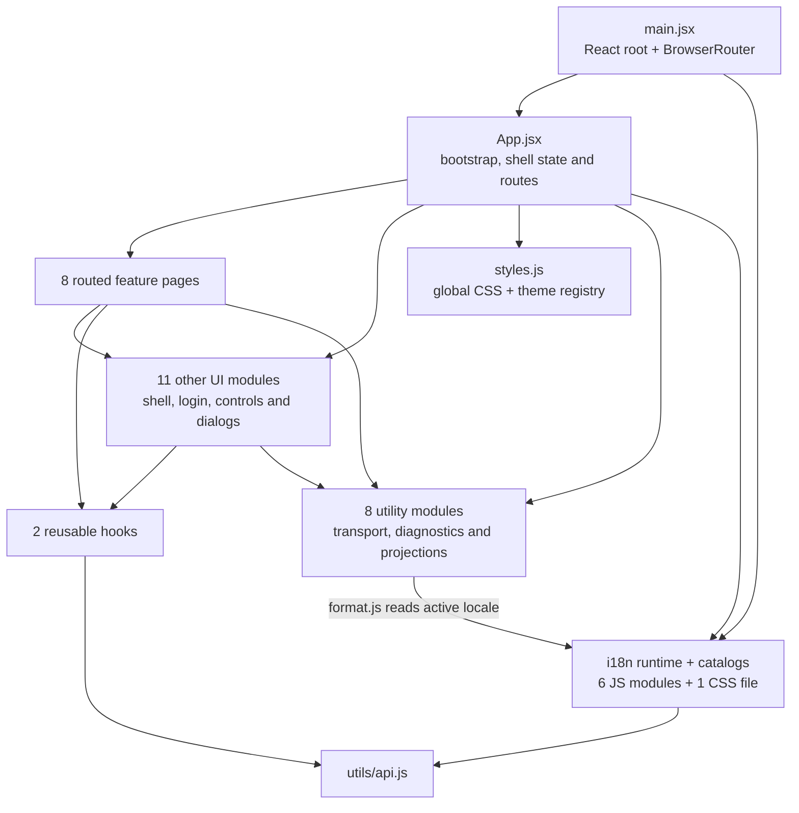

The category-level utility/i18n loop is **not** a literal file-import cycle: `format.js` imports i18n, and i18n imports `api.js`, which does not import formatting. Most components additionally depend on React/react-i18next; those package edges are omitted.

| Group | Modules | Responsibility today |
| --- | --- | --- |
| Composition | [main.jsx][fe-main], [App.jsx][fe-App] | React root, routing, application-wide settings/auth/status state and top-level services. |
| Routed features | [Dashboard][fe-components-Dashboard], [CaddyFile][fe-components-CaddyFile], [Routes][fe-components-Routes], [TLS][fe-components-TLS], [Logs][fe-components-Logs], [Metrics][fe-components-Metrics], [Notifications][fe-components-Notifications], [Instances][fe-components-Instances] | Fetch resources, manage local forms/state, interpret results and render feature controls. |
| Shell/access | [Sidebar][fe-components-Sidebar], [Login][fe-components-Login], [LanguagePicker][fe-components-LanguagePicker], [ThemePicker][fe-components-ThemePicker], [ThemeWelcome][fe-components-ThemeWelcome] | Navigation/instance selection, login, appearance/language controls and initial setup presentation. |
| Shared feature UI | [Confirm][fe-components-Confirm], [Icons][fe-components-Icons], [PaneDivider][fe-components-PaneDivider], [RouteHistoryModal][fe-components-RouteHistoryModal], [Toasts][fe-components-Toasts], [UpstreamUptime][fe-components-UpstreamUptime] | Confirmation/notification UI, artwork, editor layout, history and uptime display. Some also own data fetching. |
| Hooks | [useClickOutside][fe-hooks-useClickOutside], [useInstanceStatus][fe-hooks-useInstanceStatus] | Document-listener lifecycle and independently owned instance-status polling per hook invocation. |
| Transport/diagnostics | [api.js][fe-utils-api], [errorMessages.js][fe-utils-errorMessages], [errorRegistry.js][fe-utils-errorRegistry], [notificationCenter.js][fe-utils-notificationCenter] | HTTP normalization, credential/selection storage, error presentation and incident/toast lifetimes. |
| Projection/formatting | [routes.js][fe-utils-routes], [lineDiff.js][fe-utils-lineDiff], [logSource.js][fe-utils-logSource], [format.js][fe-utils-format] | Interpret raw Caddy trees, compute source diffs, select log source and format locale-aware values. |
| Localization | [i18n/index.js][fe-i18n-index], [i18n/fonts.js][fe-i18n-fonts], four catalog modules and [arabic.css][fe-i18n-fonts-arabic-css] | English fallback, runtime language admission, lazy catalogs, optional font loading and document language/direction. |
| Styling | [styles.js][fe-styles] | Built-in palette registry, CSS-variable contract, global layout/styles and font declarations. |

## 2. Bootstrap and rendered composition

**Runtime bootstrap.** Language and authentication effects start independently. A cached auth flag/token can initially allow the shell while the capability request is still pending.

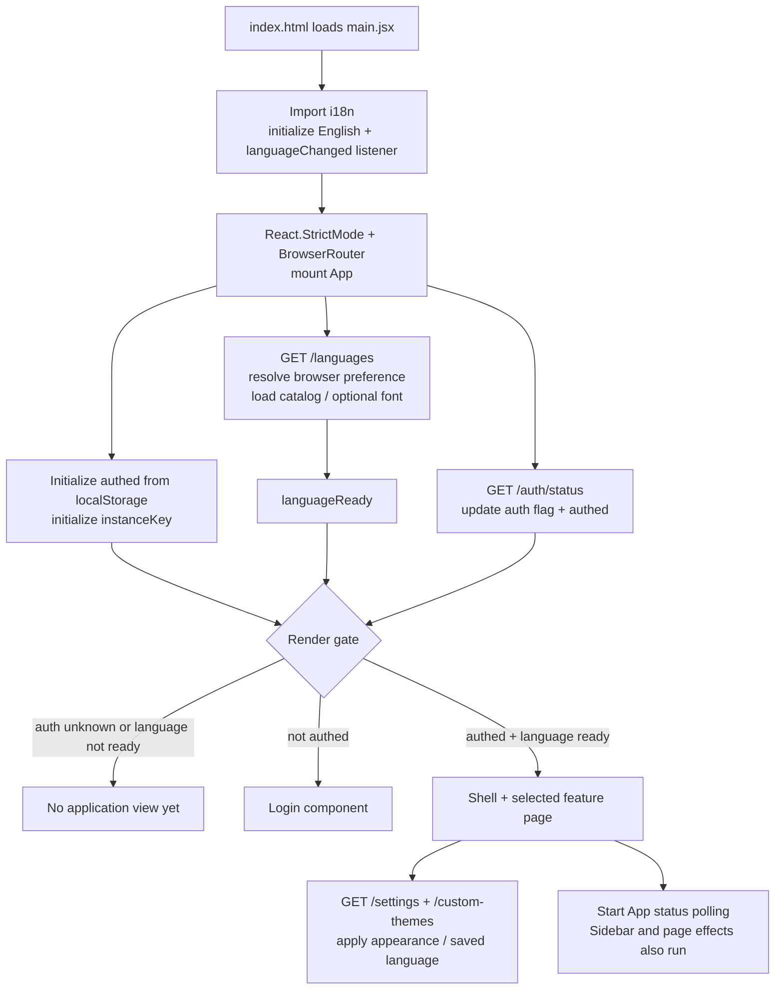

Actual failure policies in [App.jsx][fe-App]: language bootstrap falls back to English; auth-status failure sets `authed: true`; settings failure marks settings loaded and retains defaults. The UI's auth fallback does not disable backend authentication. Expired/invalid credentials are still rejected by protected API endpoints.

`StrictMode` can replay effect setup/cleanup in development. That is separate from duplicated ownership in production; it does not explain every repeated request. This map is source-based and adds no measured request-count or latency result.

**Rendered component ownership.** The toast and confirmation services are created by `App`; routed content is keyed by instance selection.

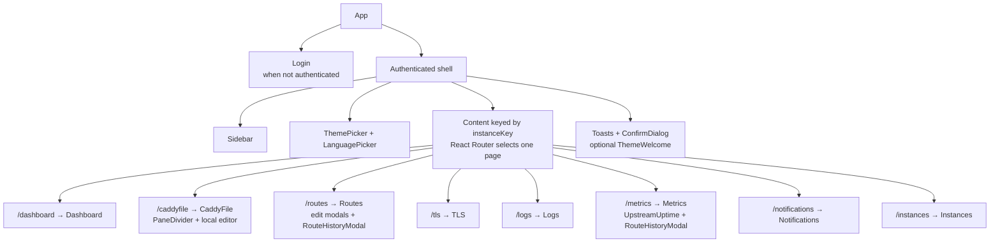

The feature-page imports are static, not `React.lazy` route imports. Editor libraries and non-English catalogs are loaded separately. `/` redirects to Dashboard or Instances; an unknown route redirects to Dashboard. When no instances are available, the application keeps Logs and Instances reachable and redirects other pages to Instances.

## 3. Selection, state lifetime and invalidation

**Runtime instance switch through Sidebar.** The browser storage value supplies request identity; `instanceKey` separately controls React content lifetime.

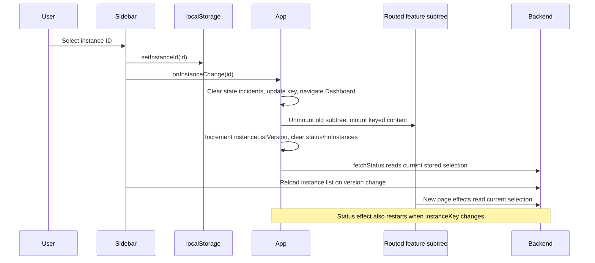

The handler explicitly calls `fetchStatus`, and the effect depends on `instanceKey`, so both paths can refresh status. This is not a central invalidation scheduler.

| State/resource | Owner and lifetime | Refresh / invalidation today |
| --- | --- | --- |
| Token, cached auth-enabled flag, selected instance | `utils/api.js` over localStorage. | Explicit setter calls; no cross-tab storage listener here. |
| Authentication gate, status, no-instance mode | `App` state. | Auth bootstrap; 15-second status poll; explicit refresh and selection callbacks. |
| Appearance, language, route display/check preferences | `App` state plus backend settings. | Initial settings fetch; optimistic local changes; persistence failures are swallowed by `persistSettings`. |
| Instance list in Sidebar | Sidebar state. | Mount and `instanceListVersion` changes. |
| Instance list in Instances | Page state. | Page load and its own mutation reloads. It is not Sidebar's list object. |
| Instance status | Each `useInstanceStatus` invocation. | Its own initial fetch and 15-second interval. |
| Routes, certificates, labels, notes, health and metrics | Individual page/subcomponent state. | Mount, feature-specific timers, local refresh or mutation handlers. |
| Source draft, source baseline and history-preview cache | CaddyFile page state/refs. | Load/save/restore/import and preview actions; destroyed with the page. |
| Notification incidents/toasts | One center created by App's `useToast()`. | Notifications, recovery, instance-state clearing, timers and App cleanup. |
| Locale resources and font requests | i18next singleton and font-loader closure. | Lazy addition/reuse; shared font promises; no application session reset. |

Keyed remounting resets page-local state; it is not a general response-cancellation contract. `apiFetch` has no selection/session generation check. Some feature effects ignore stale results locally, while others do not. App-level status and settings have lifetimes different from the keyed pages. Ordinary navigation or an instance switch can discard an unsaved page draft; there is no application-wide draft persistence or navigation guard in these modules.

## 4. API client, credentials and bypass paths

**Runtime transport contract for `apiFetch`.** HTTP-200 soft failures remain successful transport responses for consumers to interpret.

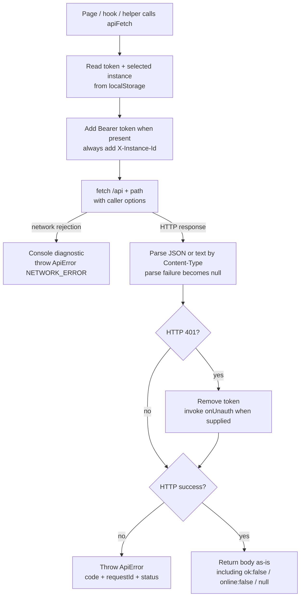

| Network path | Current owner | Credential/instance behavior |
| --- | --- | --- |
| Normal resource calls | `apiFetch` | Bearer header and selected `X-Instance-Id`; standardized non-2xx errors. |
| Login | `Login` raw `fetch` | Username/password JSON to `/auth/sessions`; returned token saved in localStorage. Local component error strings are used rather than `ApiError`. |
| Auth capabilities | App and Metrics raw `fetch` | Independent `/auth/status` requests without the shared error-normalization path. |
| Live logs | `Logs` native `EventSource` | Token in URL query; no selected-instance header or explicit instance query is added. |
| Caddyfile download | CaddyFile `window.open` | Token in URL query; no selected-instance header or explicit instance query is added. |
| Root-CA download | TLS `window.open` | Token in URL query; no selected-instance header or explicit instance query is added. |

Streams and downloads therefore do not carry the same instance-selection contract as REST. The mapped backend defaults selection when no header is supplied. These are source-level observations, not newly reproduced browser failures in this documentation task. URL credentials can also be visible to URL logging; the exact exposure depends on the surrounding deployment.

The client has no shared request cache, retry policy, resource schemas or overall request deadline. A caller can pass fetch options, but this module does not create a common abort/reconciliation mechanism. It also attaches selection to installation-wide resources. Frontend navigation and auth flags are presentation controls; backend authorization remains authoritative.

## 5. Request ownership and background refresh

**Runtime collection ownership.** A box denotes the state/timer owner. Two owners pointing at one endpoint do not share a cache merely because they call the same helper.

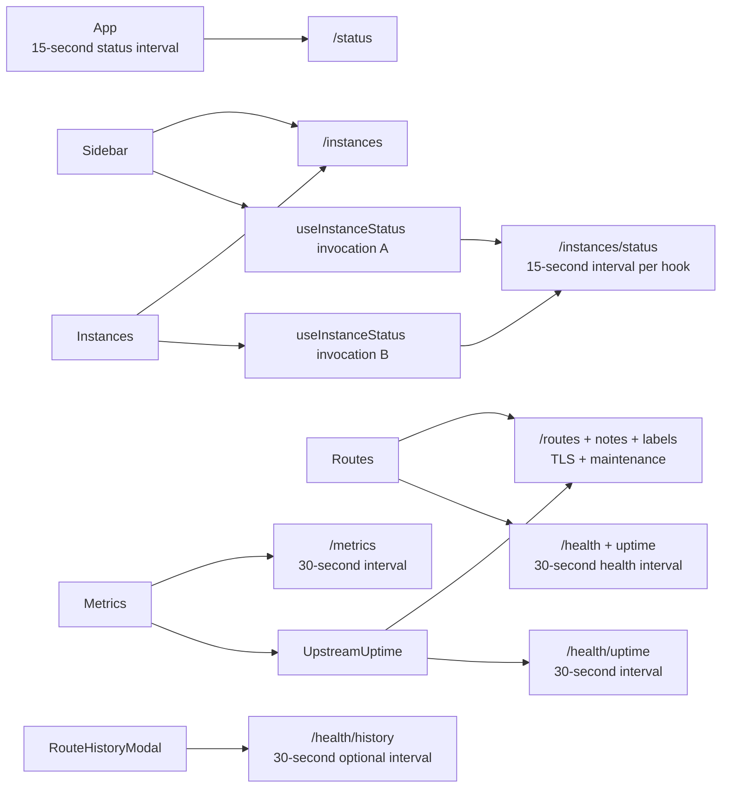

`UpstreamUptime` uses `/routes` and `/route-notes` from the grouped route-data box, not all of its other endpoints. Shared support dependencies are omitted.

| Owner | Initial reads / actions | Timer or extra refresh |
| --- | --- | --- |
| App | `/languages`, raw `/auth/status`, settings/themes, `/status`. | `/status` every 15 s when authed. Settings/themes are not polled. |
| Sidebar | `/version?frontend=...`, `/instances`, instance-status hook. | Instance-status hook every 15 s; list version triggers another list fetch. |
| Dashboard | `/server-names`, `/health`, `/status/process`. | Only process information is polled every 30 s here; status arrives separately from App. |
| Routes | `/routes`, `/tls`, `/route-notes`, `/server-names`, `/routes/maintenance`, health/uptime. | Health/uptime every 30 s; many local mutations reload both data and health. |
| Metrics | `/metrics`, `/metrics/config`, raw `/auth/status`. | Metrics every 30 s; one-second delayed refresh after enabling. |
| UpstreamUptime | `/routes`, `/route-notes`, upstream uptime, optionally route uptime. | Every 30 s; six-second refresh after route checks become enabled. |
| Instances | `/instances`, `/server-names/all`, live servers for listed admin URLs; discovery as applicable. | Discovery every 30 s; form server lookup debounced 400 ms; separate status hook. |
| TLS / Notifications / CaddyFile | Respective resources on mount. | Manual actions and local mutation reloads, not an ordinary polling interval. |
| RouteHistoryModal | Selected target history and interval metadata. | Every 30 s while automatic refresh is enabled. |
| Logs | Selected-source snapshot; Caddy log config when needed. | Explicit refresh or an explicitly opened EventSource, not snapshot polling. |

Effects also depend on callback identities/settings. For example, the Routes loading effect depends on `loadHealth`, which depends on `routeChecks`; UpstreamUptime's loader depends on translation state and route-check settings. A rerun can refresh several resources together. The table identifies ownership, not a guaranteed count for every navigation.

## 6. Caddyfile editor, draft and history contracts

**Runtime editor lifecycle.** The nested editor is defined inside CaddyFile's module; it is not a shared editor module imported by Routes.

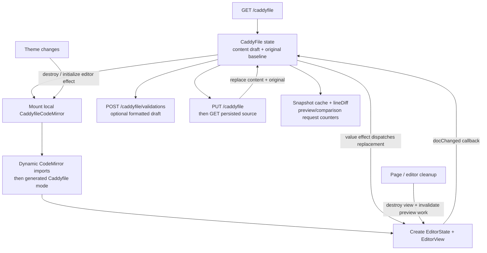

Current contracts:

- The editor receives `{ value, onChange, theme }`. Theme changes recreate its view; ordinary draft updates dispatch into the existing view. Initialization has an effect-local cancellation flag and cleanup destroys the created view.
- CodeMirror and Lezer imports are awaited in sequence in each editor implementation. Module loading can be cached by the browser, but each mounted editor still creates its own view, listeners and document state.
- `content` and `original` distinguish the local draft from the last loaded/saved baseline. No source revision/ETag is submitted with a save.
- Validation can replace the draft with `result.formatted`. Save submits current content and `fmt/sort/validate` options, then rereads the persisted file. Warnings are presented separately from ordinary success.
- Reload asks the backend to reload the file from disk; that action does not automatically replace the current draft with a new read.
- History preview uses a page-local snapshot-text cache and request counters to ignore obsolete preview/comparison/history results. This is not a global cache or universal in-flight deduplication layer.
- Restore and file import submit full source through `PUT /caddyfile`, then reread it. Export uses the separate browser-download path.
- `PaneDivider` owns DOM measurement/ResizeObserver and pointer/keyboard interaction; the parent owns the split value. No application-wide draft preservation or before-unload warning is installed here.

## 7. Route projection and edit contracts

**Runtime route editing.** Much of the interpretation remains in the feature component rather than an API read-model boundary.

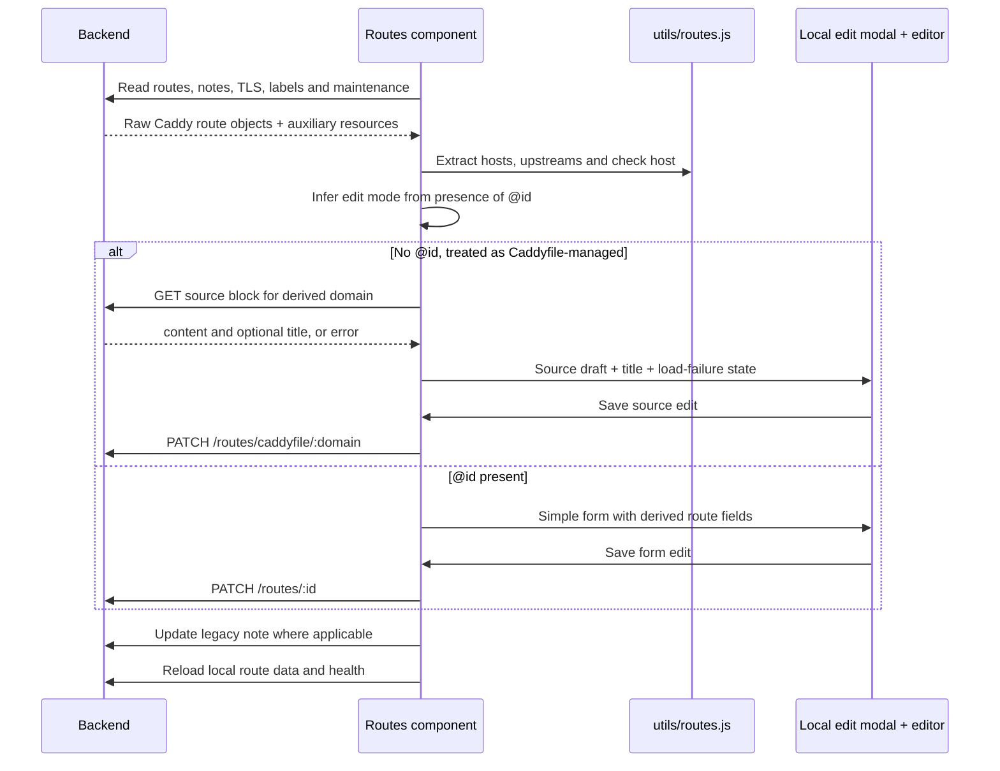

[utils/routes.js][fe-utils-routes] interprets nested Caddy handlers; Routes additionally extracts path prefixes and derives URLs. The displayed hostname can join multiple match hosts. Editing mode is inferred from `@id`; there is no explicit backend capability/provenance DTO governing all controls. Stored certificates are used to infer domain-link schemes, which is a UI heuristic rather than direct evidence of a listener's protocol.

Routes defines its own CodeMirror wrapper, separate from CaddyFile's wrapper, with similar imports and lifecycle. Route history displays are shared through RouteHistoryModal; route-edit drafts and modal state are local to Routes.

## 8. Diagnostics and the existing shared notification store

**Runtime flow.** This is a real shared-state boundary already present in the application, unlike most fetched server resources.

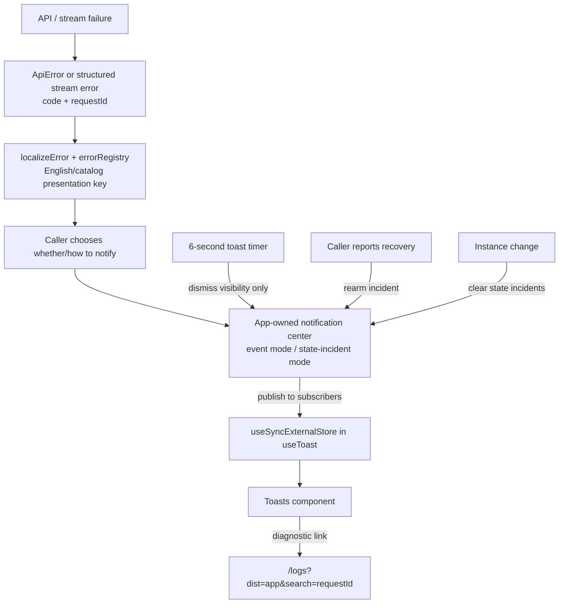

| Value/interface | Meaning today |
| --- | --- |
| `ApiError(message, { code, requestId, status })` | Normalized transport failure; code/request ID link the UI to backend diagnostics. |
| `localizeError(error, t)` | Known code to catalog key; unknown codes use a generic key rather than displaying arbitrary server messages. |
| `toast.error(message, diagnostic, policy)` | Caller explicitly chooses presentation and optional incident policy. Logging an error is not equivalent to showing a toast. |
| Event notification | A user action; repeated actions can each be visible. |
| State notification | Stable `scope:instanceId` key; repeated failures stay suppressed until recovery/clearing. Correlation IDs are not deduplication keys. |
| Notification center | Visible toast array, incident set, timers and subscribers. At most four visible toasts; default visibility six seconds. |
| `confirm(message, options)` | Promise-based confirmation with a single pending resolver in App's hook. Dialog keyboard listener is attached while open. |

The center persists for App's lifetime and resets on App cleanup. Instance switching clears state incidents while retaining user-action toasts. It is not a general event bus, API cache or durable diagnostic log. Localization keys are a separate presentation contract from backend error codes.

## 9. Log source and streaming lifecycle

**Runtime source selection and streaming.** App logs are installation-wide; Caddy logs depend on the backend's resolved instance.

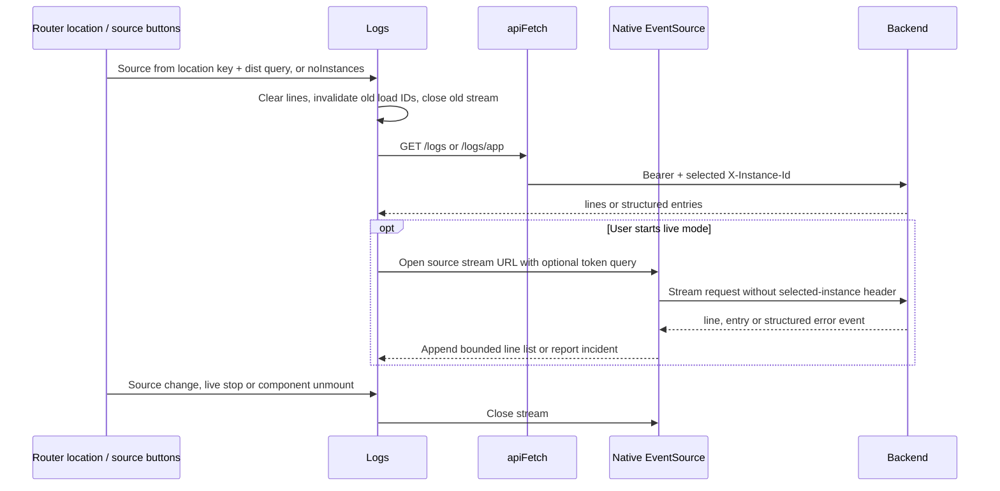

`resolveLogSource` reads `dist=app`; no-instance mode forces app logs. Manual source selection is scoped to the current React Router location key. `search` is separately synchronized from the query string. Load IDs/ignore flags protect selected snapshot updates. The live handler checks the EventSource reference before applying events; native EventSource reconnection/error behavior is not normalized by `apiFetch`.

Structured application entries are converted to JSON strings for display; Caddy logs arrive as strings. Search, level filtering, classification and Blob-based export happen in Logs. Configuration edits have a local dirty flag and are saved through `/logs/config`.

## 10. Localization, direction and fonts

**Runtime language-loading ownership.** The generated Vite locale map is a build-time capability list; the backend response determines which of those languages the UI offers.

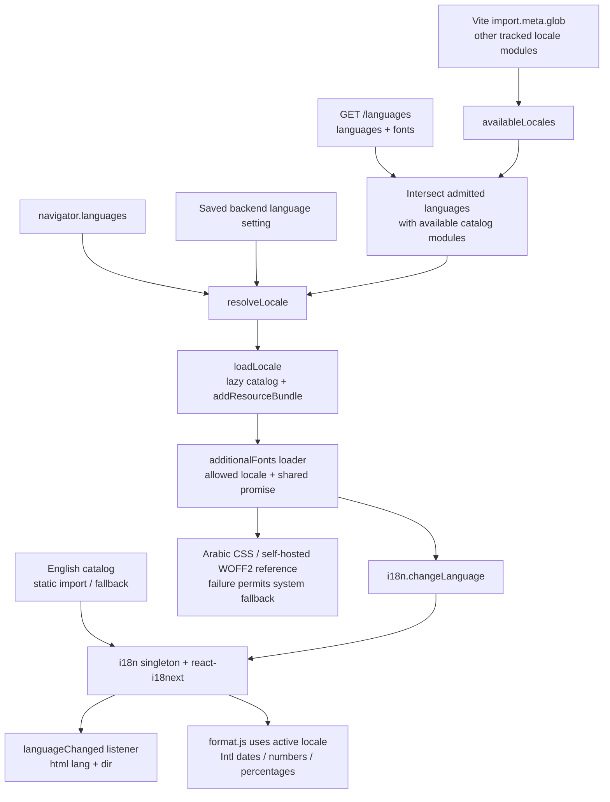

The pinned tree has English, Arabic, German and Mexican Spanish catalog modules. English is statically loaded; the other three match the lazy Vite glob. Availability in the build is not admission by the backend. The resolver prefers an admitted saved language, then a supported browser base-language candidate, then English. Settings can change the initial browser-selected language after authenticated bootstrap.

The font loader shares promises per supported font locale, tolerates failures and permits retries after failure. Its only registered extra-font loader here is Arabic CSS. This map does not assert that proposed build-time language/font settings are already implemented. The global stylesheet also imports IBM Plex through Google Fonts, independently of the self-hosted Arabic asset path.

## 11. Appearance and DOM responsibilities

**Runtime ownership.** Appearance preferences live in App, while presentation components report user choices through callbacks.

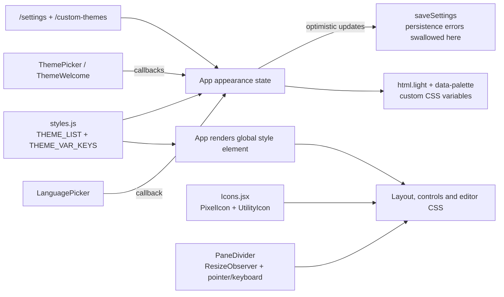

`ThemePicker` also exports custom-theme JSON through a local Blob/object URL. `styles.js` is executable JavaScript exporting theme data and a large stylesheet string, not a directory of component-scoped styles. Icons are inline SVG components using named variants. Theme and direction changes affect shared DOM/CSS; CodeMirror wrappers also respond to their `theme` prop.

## 12. Current data and prop contracts

**Structural values, not newly proposed classes.** These names describe data already passed between the listed modules.

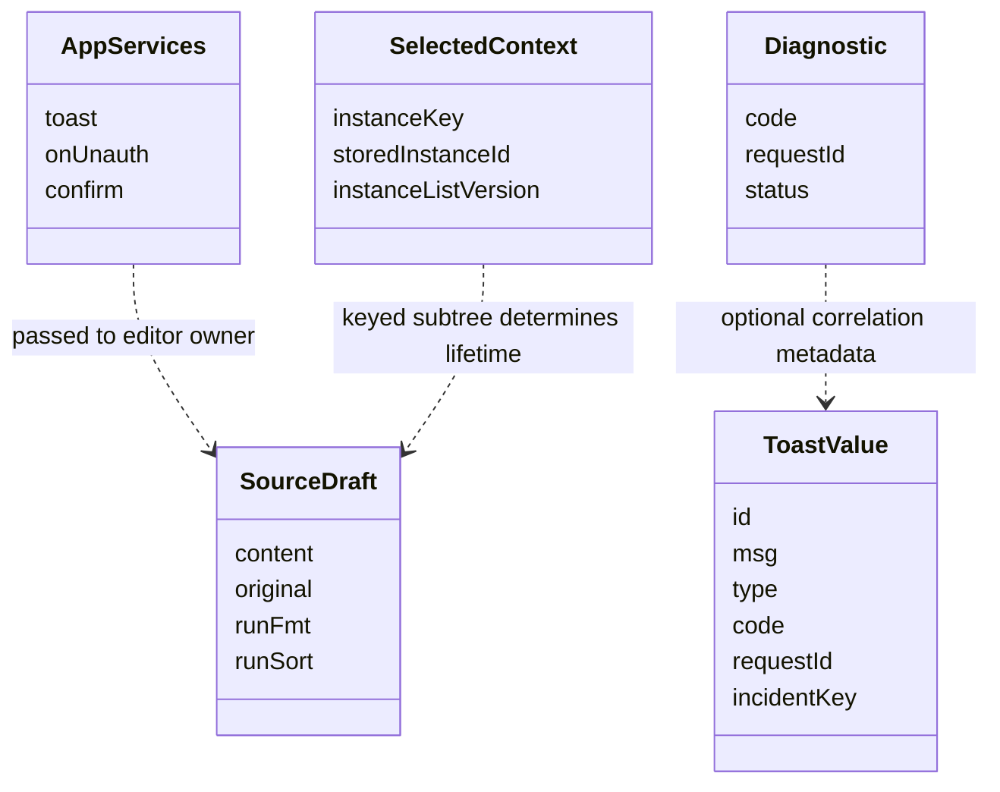

| Interface / shape | Producer → consumer | Contract limitation |
| --- | --- | --- |
| Shared callbacks `{ toast, onUnauth, confirm }` | App → feature props. | Passed explicitly; not a dedicated application-service provider/context. |
| `status` summary | App API effect → Sidebar and Dashboard. | Includes backend `online` soft failures; other fetch failures become a local offline/error-key value. |
| Selected context | localStorage helpers + App state → API calls and keyed content. | Stored ID, rendered key and list-version invalidation are separate values, not an atomic scoped request context. |
| Route view | Backend raw Caddy route + `_server`/`_simpleProxy` → Routes and uptime projections. | Nested handlers, hosts, IDs and auxiliary notes/certs drive UI assumptions. |
| Caddyfile draft | API read / local editor → validation and save requests. | Plain text plus local baseline; no expected revision in this request contract. |
| Configuration forms | API objects → Notifications, Logs, Instances, Metrics. | Local drafts and ad hoc response handling; no shared response-schema validator. Notification test uses backend-saved config, not the unsaved local draft. |
| Snapshot/history payloads | Backend → CaddyFile / RouteHistoryModal. | Source snapshots and sampled health history are distinct resources with different identities. |
| Theme entry | Built-in registry or backend catalogue → App/pickers. | Shared variable-key set and palette identity couple styles, backend custom-theme validation and controls. |
| Notification state | Framework-independent center → React through `useSyncExternalStore`. | Real subscription contract with explicit recovery/visibility semantics; no resource fetching. |

The backend map describes resource production and persistence; this map describes consumption. The same resource can have several local consumers with different refresh and fallback policies.

## 13. Build and browser integration boundaries

**Build/runtime assembly.** Vite builds the browser application; nginx serves it and proxies API calls in production.

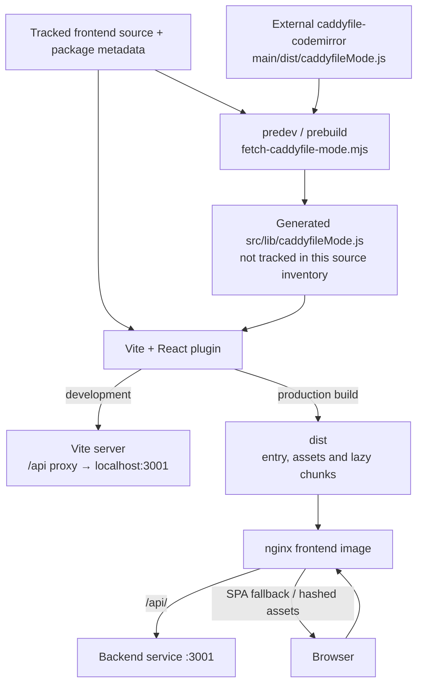

Relevant inputs are [index.html][fe-build-index], [vite.config.js][fe-build-vite], [package.json][fe-build-package], the [grammar fetch script][fe-build-grammar], [Dockerfile][fe-build-docker] and [nginx.conf][fe-build-nginx].

- The pre-step fetches an external mutable source URL; an existing local grammar is retained if fetching fails. Without a local copy, fetch failure stops that step. A pinned application revision alone does not identify the generated grammar bytes used by every build.
- Production build currently installs with `npm install` after copying `package.json`; it does not install from the tracked lockfile in this Dockerfile. This is an existing reproducibility boundary, not a change introduced by the map.
- nginx has an SPA fallback, immutable caching for hashed assets and text gzip configuration; `/api/` is proxied to the backend. It does not run the React application as a Node service.
- Vite glob catalog loading, dynamic CodeMirror imports and font CSS add distinct browser resources. Their presence does not by itself quantify an optimization opportunity or loading penalty.

## 14. Existing seams for future slices

**Selected dependency detail.** The dotted grammar edges are dynamic imports, and the dashed locale family is a Vite-generated lazy import set.

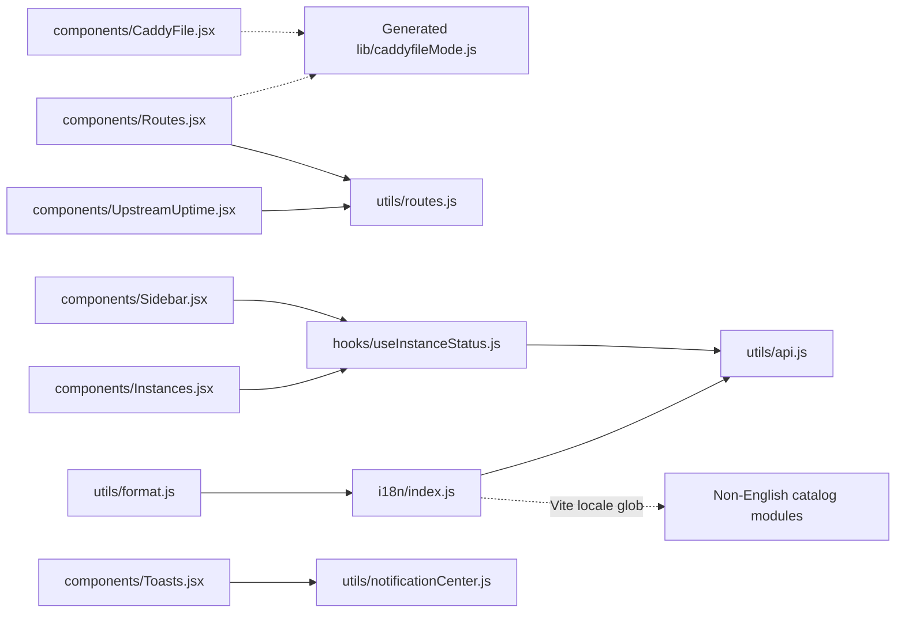

| Existing seam | Why it matters |
| --- | --- |
| App combines composition, authentication, appearance, localization and status collection. | Changing one concern requires understanding several effect lifetimes and shared callbacks. |
| Pages combine transport, interpretation, drafts, mutation sequencing and rendering. | Shared resource contracts are largely consumer expectations rather than enforced read interfaces. |
| Instance-status helper owns state per invocation. | Reusing the hook reuses implementation, not its result or timer. |
| Similar CodeMirror wrappers live in two page modules. | Shared editor behavior and integration fixes can drift, even though browser module loading is cached. |
| REST, streams and downloads select credentials/identity differently. | A UI selection does not automatically establish the same backend target for every transport. |
| Existing incident store and font loader establish limited shared ownership. | They are useful examples of explicit lifetimes; a frontend-wide rewrite is not required to share one resource. |
| English keys, backend codes and theme-variable keys span packages. | These are concrete cross-package contracts, separate from module-import boundaries. |

This is a map of current seams, not a recommendation to replace React Router, introduce a large state framework or redesign authentication. Future slices can clarify one owner/contract at a time while preserving the Caddyfile-first workflow.

## 15. Complete local-import inventory

All 38 tracked JavaScript/JSX modules and their direct local dependencies

The inventory includes literal relative static, side-effect and dynamic imports, plus the current matches of i18n's Vite locale glob. npm dependencies and browser globals are excluded. The grammar is marked generated instead of linked to a nonexistent tracked source file. Arabic CSS is a tracked local dependency; its WOFF2 reference is an npm asset, not another JavaScript module.

| Module | Direct local dependencies |
| --- | --- |
| [App.jsx][fe-App] | [components/CaddyFile.jsx][fe-components-CaddyFile], [components/Icons.jsx][fe-components-Icons], [components/Confirm.jsx][fe-components-Confirm], [components/Dashboard.jsx][fe-components-Dashboard], [components/Login.jsx][fe-components-Login], [components/Logs.jsx][fe-components-Logs], [components/Metrics.jsx][fe-components-Metrics], [components/Instances.jsx][fe-components-Instances], [components/Notifications.jsx][fe-components-Notifications], [components/Routes.jsx][fe-components-Routes], [components/Sidebar.jsx][fe-components-Sidebar], [components/ThemePicker.jsx][fe-components-ThemePicker], [components/LanguagePicker.jsx][fe-components-LanguagePicker], [i18n/index.js][fe-i18n-index], [components/ThemeWelcome.jsx][fe-components-ThemeWelcome], [components/TLS.jsx][fe-components-TLS], [components/Toasts.jsx][fe-components-Toasts], [styles.js][fe-styles], [utils/api.js][fe-utils-api] |
| [components/CaddyFile.jsx][fe-components-CaddyFile] | [components/Icons.jsx][fe-components-Icons], [utils/errorMessages.js][fe-utils-errorMessages], [components/PaneDivider.jsx][fe-components-PaneDivider], [utils/api.js][fe-utils-api], [utils/notificationCenter.js][fe-utils-notificationCenter], [utils/format.js][fe-utils-format], [utils/lineDiff.js][fe-utils-lineDiff], `lib/caddyfileMode.js` (generated; [fetch script][fe-build-grammar]) (dynamic) |
| [components/Confirm.jsx][fe-components-Confirm] | None |
| [components/Dashboard.jsx][fe-components-Dashboard] | [components/Icons.jsx][fe-components-Icons], [utils/errorMessages.js][fe-utils-errorMessages], [utils/api.js][fe-utils-api], [utils/format.js][fe-utils-format] |
| [components/Icons.jsx][fe-components-Icons] | None |
| [components/Instances.jsx][fe-components-Instances] | [components/Icons.jsx][fe-components-Icons], [utils/errorMessages.js][fe-utils-errorMessages], [hooks/useInstanceStatus.js][fe-hooks-useInstanceStatus], [utils/api.js][fe-utils-api], [utils/notificationCenter.js][fe-utils-notificationCenter] |
| [components/LanguagePicker.jsx][fe-components-LanguagePicker] | [components/Icons.jsx][fe-components-Icons], [i18n/index.js][fe-i18n-index] |
| [components/Login.jsx][fe-components-Login] | [utils/api.js][fe-utils-api] |
| [components/Logs.jsx][fe-components-Logs] | [components/Icons.jsx][fe-components-Icons], [utils/errorMessages.js][fe-utils-errorMessages], [utils/api.js][fe-utils-api], [utils/notificationCenter.js][fe-utils-notificationCenter], [utils/logSource.js][fe-utils-logSource] |
| [components/Metrics.jsx][fe-components-Metrics] | [components/Icons.jsx][fe-components-Icons], [utils/errorMessages.js][fe-utils-errorMessages], [utils/api.js][fe-utils-api], [utils/format.js][fe-utils-format], [components/UpstreamUptime.jsx][fe-components-UpstreamUptime] |
| [components/Notifications.jsx][fe-components-Notifications] | [components/Icons.jsx][fe-components-Icons], [utils/errorMessages.js][fe-utils-errorMessages], [utils/api.js][fe-utils-api] |
| [components/PaneDivider.jsx][fe-components-PaneDivider] | [utils/format.js][fe-utils-format] |
| [components/RouteHistoryModal.jsx][fe-components-RouteHistoryModal] | [utils/errorMessages.js][fe-utils-errorMessages], [utils/api.js][fe-utils-api], [utils/format.js][fe-utils-format] |
| [components/Routes.jsx][fe-components-Routes] | [components/Icons.jsx][fe-components-Icons], [utils/errorMessages.js][fe-utils-errorMessages], [hooks/useClickOutside.js][fe-hooks-useClickOutside], [components/RouteHistoryModal.jsx][fe-components-RouteHistoryModal], [utils/api.js][fe-utils-api], [utils/format.js][fe-utils-format], [utils/notificationCenter.js][fe-utils-notificationCenter], [utils/routes.js][fe-utils-routes], `lib/caddyfileMode.js` (generated; [fetch script][fe-build-grammar]) (dynamic) |
| [components/Sidebar.jsx][fe-components-Sidebar] | [components/Icons.jsx][fe-components-Icons], [hooks/useClickOutside.js][fe-hooks-useClickOutside], [hooks/useInstanceStatus.js][fe-hooks-useInstanceStatus], [utils/api.js][fe-utils-api] |
| [components/TLS.jsx][fe-components-TLS] | [components/Icons.jsx][fe-components-Icons], [utils/errorMessages.js][fe-utils-errorMessages], [utils/api.js][fe-utils-api], [utils/format.js][fe-utils-format], [utils/notificationCenter.js][fe-utils-notificationCenter] |
| [components/ThemePicker.jsx][fe-components-ThemePicker] | [hooks/useClickOutside.js][fe-hooks-useClickOutside], [styles.js][fe-styles], [components/Icons.jsx][fe-components-Icons] |
| [components/ThemeWelcome.jsx][fe-components-ThemeWelcome] | [components/Icons.jsx][fe-components-Icons], [i18n/index.js][fe-i18n-index] |
| [components/Toasts.jsx][fe-components-Toasts] | [utils/notificationCenter.js][fe-utils-notificationCenter] |
| [components/UpstreamUptime.jsx][fe-components-UpstreamUptime] | [utils/errorMessages.js][fe-utils-errorMessages], [components/RouteHistoryModal.jsx][fe-components-RouteHistoryModal], [utils/api.js][fe-utils-api], [utils/format.js][fe-utils-format], [utils/routes.js][fe-utils-routes] |
| [hooks/useClickOutside.js][fe-hooks-useClickOutside] | None |
| [hooks/useInstanceStatus.js][fe-hooks-useInstanceStatus] | [utils/api.js][fe-utils-api] |
| [i18n/fonts.js][fe-i18n-fonts] | [i18n/fonts/arabic.css][fe-i18n-fonts-arabic-css] (dynamic) |
| [i18n/index.js][fe-i18n-index] | [utils/api.js][fe-utils-api], [i18n/locales/en.js][fe-i18n-locales-en], [i18n/fonts.js][fe-i18n-fonts], [i18n/locales/ar.js][fe-i18n-locales-ar] (Vite glob), [i18n/locales/de.js][fe-i18n-locales-de] (Vite glob), [i18n/locales/es-mx.js][fe-i18n-locales-es-mx] (Vite glob) |
| [i18n/locales/ar.js][fe-i18n-locales-ar] | None |
| [i18n/locales/de.js][fe-i18n-locales-de] | None |
| [i18n/locales/en.js][fe-i18n-locales-en] | None |
| [i18n/locales/es-mx.js][fe-i18n-locales-es-mx] | None |
| [main.jsx][fe-main] | [App.jsx][fe-App], [i18n/index.js][fe-i18n-index] (side-effect) |
| [styles.js][fe-styles] | None |
| [utils/api.js][fe-utils-api] | None |
| [utils/errorMessages.js][fe-utils-errorMessages] | [utils/errorRegistry.js][fe-utils-errorRegistry] |
| [utils/errorRegistry.js][fe-utils-errorRegistry] | None |
| [utils/format.js][fe-utils-format] | [i18n/index.js][fe-i18n-index] |
| [utils/lineDiff.js][fe-utils-lineDiff] | None |
| [utils/logSource.js][fe-utils-logSource] | None |
| [utils/notificationCenter.js][fe-utils-notificationCenter] | None |
| [utils/routes.js][fe-utils-routes] | None |

## Updating and validating this map

Update the pinned revision, module coverage, route composition, import inventory and affected runtime contracts together. Review the same backend revision when changing a request/response or selection contract. Keep generated grammar and Vite-glob inputs explicit rather than silently treating them as ordinary tracked imports.

This is source inspection and documentation validation. No application code was changed or new browser-performance measurement taken for this map. Diagram rendering and source-reference checks do not replace frontend or real-backend integration tests.

Documentation checks: all 15 Mermaid diagrams were parsed and rendered with Mermaid 12.2.0 in headless Chromium. Source coverage was checked for all 38 tracked JS/JSX modules, the font stylesheet and six build/configuration references, together with local document links. Representative diagrams were visually inspected.

[fe-App]: https://github.com/zackwag/caddy-ui/blob/72bba1f22ea1145515c85a87fb90f560e4088a4d/src/frontend/src/App.jsx
[fe-components-CaddyFile]: https://github.com/zackwag/caddy-ui/blob/72bba1f22ea1145515c85a87fb90f560e4088a4d/src/frontend/src/components/CaddyFile.jsx
[fe-components-Confirm]: https://github.com/zackwag/caddy-ui/blob/72bba1f22ea1145515c85a87fb90f560e4088a4d/src/frontend/src/components/Confirm.jsx
[fe-components-Dashboard]: https://github.com/zackwag/caddy-ui/blob/72bba1f22ea1145515c85a87fb90f560e4088a4d/src/frontend/src/components/Dashboard.jsx
[fe-components-Icons]: https://github.com/zackwag/caddy-ui/blob/72bba1f22ea1145515c85a87fb90f560e4088a4d/src/frontend/src/components/Icons.jsx
[fe-components-Instances]: https://github.com/zackwag/caddy-ui/blob/72bba1f22ea1145515c85a87fb90f560e4088a4d/src/frontend/src/components/Instances.jsx
[fe-components-LanguagePicker]: https://github.com/zackwag/caddy-ui/blob/72bba1f22ea1145515c85a87fb90f560e4088a4d/src/frontend/src/components/LanguagePicker.jsx
[fe-components-Login]: https://github.com/zackwag/caddy-ui/blob/72bba1f22ea1145515c85a87fb90f560e4088a4d/src/frontend/src/components/Login.jsx
[fe-components-Logs]: https://github.com/zackwag/caddy-ui/blob/72bba1f22ea1145515c85a87fb90f560e4088a4d/src/frontend/src/components/Logs.jsx
[fe-components-Metrics]: https://github.com/zackwag/caddy-ui/blob/72bba1f22ea1145515c85a87fb90f560e4088a4d/src/frontend/src/components/Metrics.jsx
[fe-components-Notifications]: https://github.com/zackwag/caddy-ui/blob/72bba1f22ea1145515c85a87fb90f560e4088a4d/src/frontend/src/components/Notifications.jsx
[fe-components-PaneDivider]: https://github.com/zackwag/caddy-ui/blob/72bba1f22ea1145515c85a87fb90f560e4088a4d/src/frontend/src/components/PaneDivider.jsx
[fe-components-RouteHistoryModal]: https://github.com/zackwag/caddy-ui/blob/72bba1f22ea1145515c85a87fb90f560e4088a4d/src/frontend/src/components/RouteHistoryModal.jsx
[fe-components-Routes]: https://github.com/zackwag/caddy-ui/blob/72bba1f22ea1145515c85a87fb90f560e4088a4d/src/frontend/src/components/Routes.jsx
[fe-components-Sidebar]: https://github.com/zackwag/caddy-ui/blob/72bba1f22ea1145515c85a87fb90f560e4088a4d/src/frontend/src/components/Sidebar.jsx
[fe-components-TLS]: https://github.com/zackwag/caddy-ui/blob/72bba1f22ea1145515c85a87fb90f560e4088a4d/src/frontend/src/components/TLS.jsx
[fe-components-ThemePicker]: https://github.com/zackwag/caddy-ui/blob/72bba1f22ea1145515c85a87fb90f560e4088a4d/src/frontend/src/components/ThemePicker.jsx
[fe-components-ThemeWelcome]: https://github.com/zackwag/caddy-ui/blob/72bba1f22ea1145515c85a87fb90f560e4088a4d/src/frontend/src/components/ThemeWelcome.jsx
[fe-components-Toasts]: https://github.com/zackwag/caddy-ui/blob/72bba1f22ea1145515c85a87fb90f560e4088a4d/src/frontend/src/components/Toasts.jsx
[fe-components-UpstreamUptime]: https://github.com/zackwag/caddy-ui/blob/72bba1f22ea1145515c85a87fb90f560e4088a4d/src/frontend/src/components/UpstreamUptime.jsx
[fe-hooks-useClickOutside]: https://github.com/zackwag/caddy-ui/blob/72bba1f22ea1145515c85a87fb90f560e4088a4d/src/frontend/src/hooks/useClickOutside.js
[fe-hooks-useInstanceStatus]: https://github.com/zackwag/caddy-ui/blob/72bba1f22ea1145515c85a87fb90f560e4088a4d/src/frontend/src/hooks/useInstanceStatus.js
[fe-i18n-fonts]: https://github.com/zackwag/caddy-ui/blob/72bba1f22ea1145515c85a87fb90f560e4088a4d/src/frontend/src/i18n/fonts.js
[fe-i18n-index]: https://github.com/zackwag/caddy-ui/blob/72bba1f22ea1145515c85a87fb90f560e4088a4d/src/frontend/src/i18n/index.js
[fe-i18n-locales-ar]: https://github.com/zackwag/caddy-ui/blob/72bba1f22ea1145515c85a87fb90f560e4088a4d/src/frontend/src/i18n/locales/ar.js
[fe-i18n-locales-de]: https://github.com/zackwag/caddy-ui/blob/72bba1f22ea1145515c85a87fb90f560e4088a4d/src/frontend/src/i18n/locales/de.js
[fe-i18n-locales-en]: https://github.com/zackwag/caddy-ui/blob/72bba1f22ea1145515c85a87fb90f560e4088a4d/src/frontend/src/i18n/locales/en.js
[fe-i18n-locales-es-mx]: https://github.com/zackwag/caddy-ui/blob/72bba1f22ea1145515c85a87fb90f560e4088a4d/src/frontend/src/i18n/locales/es-mx.js
[fe-main]: https://github.com/zackwag/caddy-ui/blob/72bba1f22ea1145515c85a87fb90f560e4088a4d/src/frontend/src/main.jsx
[fe-styles]: https://github.com/zackwag/caddy-ui/blob/72bba1f22ea1145515c85a87fb90f560e4088a4d/src/frontend/src/styles.js
[fe-utils-api]: https://github.com/zackwag/caddy-ui/blob/72bba1f22ea1145515c85a87fb90f560e4088a4d/src/frontend/src/utils/api.js
[fe-utils-errorMessages]: https://github.com/zackwag/caddy-ui/blob/72bba1f22ea1145515c85a87fb90f560e4088a4d/src/frontend/src/utils/errorMessages.js
[fe-utils-errorRegistry]: https://github.com/zackwag/caddy-ui/blob/72bba1f22ea1145515c85a87fb90f560e4088a4d/src/frontend/src/utils/errorRegistry.js
[fe-utils-format]: https://github.com/zackwag/caddy-ui/blob/72bba1f22ea1145515c85a87fb90f560e4088a4d/src/frontend/src/utils/format.js
[fe-utils-lineDiff]: https://github.com/zackwag/caddy-ui/blob/72bba1f22ea1145515c85a87fb90f560e4088a4d/src/frontend/src/utils/lineDiff.js
[fe-utils-logSource]: https://github.com/zackwag/caddy-ui/blob/72bba1f22ea1145515c85a87fb90f560e4088a4d/src/frontend/src/utils/logSource.js
[fe-utils-notificationCenter]: https://github.com/zackwag/caddy-ui/blob/72bba1f22ea1145515c85a87fb90f560e4088a4d/src/frontend/src/utils/notificationCenter.js
[fe-utils-routes]: https://github.com/zackwag/caddy-ui/blob/72bba1f22ea1145515c85a87fb90f560e4088a4d/src/frontend/src/utils/routes.js
[fe-i18n-fonts-arabic-css]: https://github.com/zackwag/caddy-ui/blob/72bba1f22ea1145515c85a87fb90f560e4088a4d/src/frontend/src/i18n/fonts/arabic.css
[fe-build-index]: https://github.com/zackwag/caddy-ui/blob/72bba1f22ea1145515c85a87fb90f560e4088a4d/src/frontend/index.html
[fe-build-vite]: https://github.com/zackwag/caddy-ui/blob/72bba1f22ea1145515c85a87fb90f560e4088a4d/src/frontend/vite.config.js
[fe-build-package]: https://github.com/zackwag/caddy-ui/blob/72bba1f22ea1145515c85a87fb90f560e4088a4d/src/frontend/package.json
[fe-build-grammar]: https://github.com/zackwag/caddy-ui/blob/72bba1f22ea1145515c85a87fb90f560e4088a4d/src/frontend/scripts/fetch-caddyfile-mode.mjs
[fe-build-docker]: https://github.com/zackwag/caddy-ui/blob/72bba1f22ea1145515c85a87fb90f560e4088a4d/src/frontend/Dockerfile
[fe-build-nginx]: https://github.com/zackwag/caddy-ui/blob/72bba1f22ea1145515c85a87fb90f560e4088a4d/src/frontend/nginx.conf
